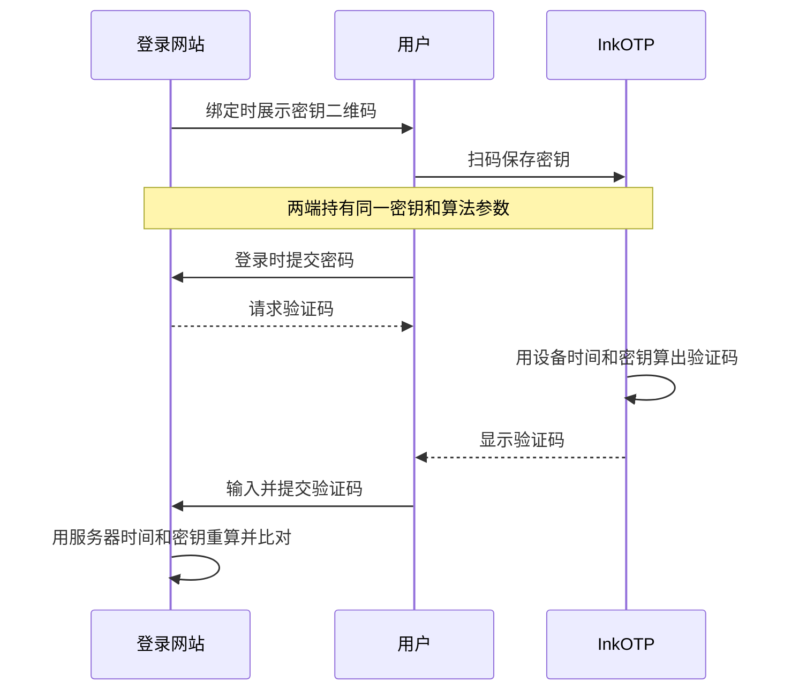

# InkOTP

InkOTP 是一款离线两步验证器，适用于 Android、iPhone、iPad 和 Mac。它把账号密钥加密保存在设备上，用设备时间计算登录所需的一次性验证码。

[官网](https://inkotp.renhongchang.top/) · [隐私声明](https://inkotp.renhongchang.top/privacy/) · [下载](https://github.com/rhczz/ink-otp/releases)

## 安装与使用

三端共用一个版本号。在同一个 [GitHub Release](https://github.com/rhczz/ink-otp/releases) 的 **Assets** 里选对应文件。

| 平台 | 下载与安装 |
| --- | --- |
| Android 8.0+ | 下载签名 APK。 |
| macOS 14+ | 下载通用 DMG，支持 Apple Silicon 和 Intel。首次打开见 [Mac 安装说明](macos/README.md)。 |
| iOS / iPadOS 17+ | iPhone、iPad 使用 IPA，未签名包需自行签名后安装。Xcode 模拟器使用 ZIP。 [iOS 安装说明](ios/README.md) |

在网站的账号安全设置启用验证器，用 InkOTP 扫描网站提供的二维码，再把显示的验证码填回网站完成绑定。之后登录时，打开该账号对应的卡片取码。

换机时可导出 Aegis 加密备份，也可使用 2FAS 文件、otpauth 文本或 Google Authenticator 迁移二维码。 [备份格式](spec/interoperability.md) · [Google Authenticator 迁移](spec/google-authenticator-transfer.md)

## TOTP 是怎么工作的

TOTP 是基于时间的一次性密码。绑定时，网站和 InkOTP 各保存同一份**共享密钥**。登录时，两边各用自己的时钟和这份密钥计算验证码。InkOTP 负责本地出码，网站负责校验。

**验证码怎么变？** 以常见的 30 秒周期为例，InkOTP 将 Unix 时间除以 30 并向下取整，得到时间计数器。它用密钥对计数器计算 HMAC，再截取并取模，得到指定位数的验证码。比如 `12:00:00` 到 `12:00:29` 用同一个计数器，`12:00:30` 起用下一个。 [RFC 6238](https://www.rfc-editor.org/rfc/rfc6238.html#section-4) · [RFC 4226](https://www.rfc-editor.org/rfc/rfc4226.html#section-5.3)

**网站怎么判定？** 网站通常按收到验证码的时间计算预期值，也可以按策略检查临近时段，容纳输码耗时或时钟偏差。服务端应在有效期内只接受同一验证码一次，以防止重放。 [RFC 6238](https://www.rfc-editor.org/rfc/rfc6238.html#section-5.2)

**离线有什么用？** 设备上已有密钥和时钟，飞行模式也能出码。填写验证码时只提交当次短码，密钥留在本机。二维码和明文迁移件包含长期密钥，拿到它的人可以继续生成验证码。 [读完整原理与算例](docs/totp.md)

## 文档

[开发与文档索引](docs/README.md) · [安全问题报告](SECURITY.md) · [GPL-3.0 许可证](LICENSE)
