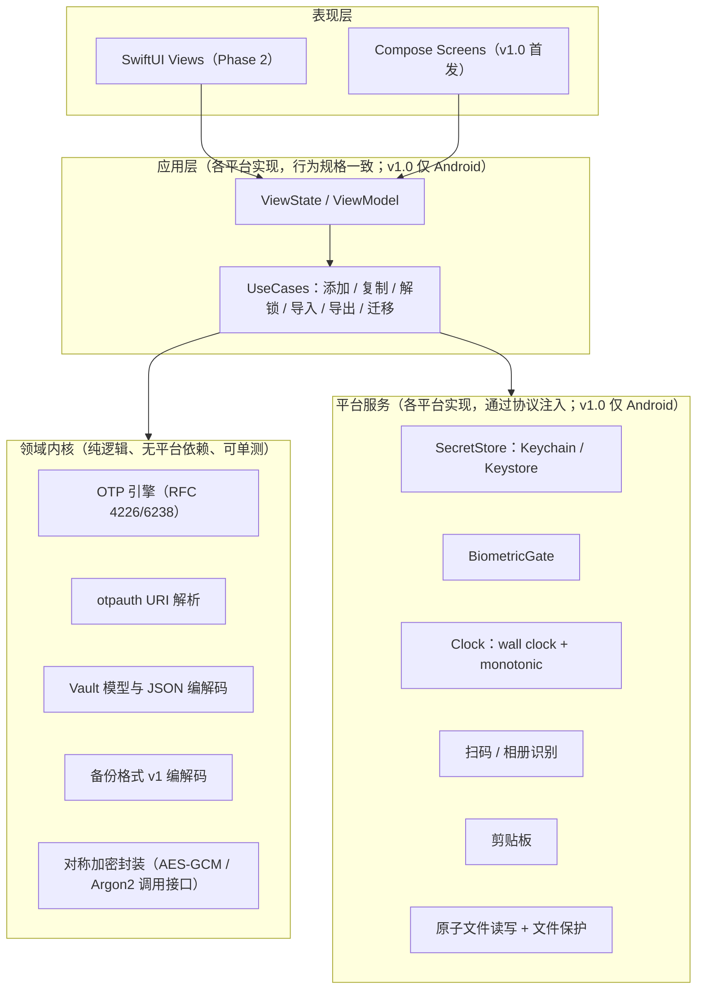
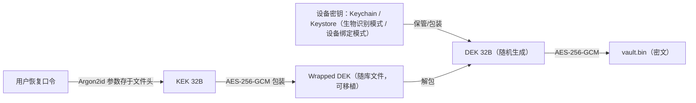
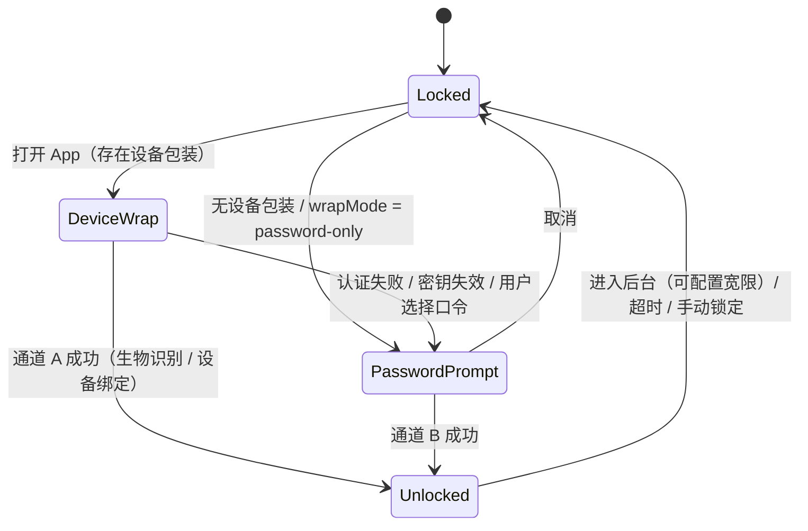
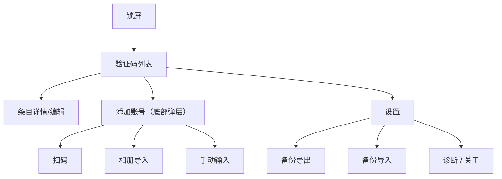

# InkOTP · 两步验证器技术设计

本文是 InkOTP 架构、安全设计和工程约束的权威文档，保留 Android 首发规划及后续 ADR。原计划里的实施范围、版本和里程碑按当时的语境阅读。三端当前的交互和数据契约集中在[规格索引](../../spec/README.md)。

| 查阅内容 | 规格 |
| --- | --- |
| 平台行为 | [Android](../../spec/android-interaction.md)、[iOS/iPadOS](../../spec/ios-parity.md)、[macOS](../../spec/macos-parity.md) |
| 本地存储 | [本地库布局](../../spec/vault-format.md)、[跨平台边界](../platform-neutrality.md) |
| 备份与迁移 | [交换兼容矩阵](../../spec/interoperability.md)、[Google Authenticator 二维码](../../spec/google-authenticator-transfer.md) |
| 构建与分发 | [开发指南](../development.md)、[三端发布契约](../../spec/release.md) |

## 0. 摘要

- InkOTP 在设备上生成一次性验证码。账号种子存入本地加密库，用户可通过加密备份和有效口令恢复账号。验证码的时间步长和算法见 [TOTP 原理](../totp.md)与[公共向量](../../spec/vectors.json)。
- Android、iOS 和 macOS 使用各自的原生系统接口，共用适用的数据和测试契约。平台密钥保存在系统安全存储，各端应用均支持离线使用。
- 应用名称为 **InkOTP**，Android applicationId 为 `io.github.rhczz.inkotp`，许可证为 **GPL-3.0**。相关决定见 §3。
- 工程约束、变更流程和验收门禁见 §18。Android 首发规划见 §2、ADR-013 和 §15。三端统一发布及当前交换格式见 ADR-032 和 ADR-033。

---

## 1. 背景与目标

### 1.1 背景

双因素认证 = 你知道的（密码）+ 你拥有的（第二因素）。TOTP 验证器保存的是各服务的共享密钥（`secret`），用标准算法（[RFC 4226](https://www.rfc-editor.org/rfc/rfc4226) HOTP / [RFC 6238](https://www.rfc-editor.org/rfc/rfc6238) TOTP）在 30 秒时间窗内派生一次性验证码。二维码内容通常是 [Key Uri Format](https://github.com/google/google-authenticator/wiki/Key-Uri-Format) 的 `otpauth://totp/...` URI。

这个品类的特殊性在于：**它是用户全部账号的第二把钥匙**。功能做少一点没关系，做错一次就是灾难。因此本文档把"安全 / 可恢复 / 可验证"放在"功能多"之上。

### 1.2 目标

| 编号 | 目标 | 衡量方式 |
|---|---|---|
| G1 | 离线可用，无网络也能完整工作 | 应用无网络权限；断网全流程可用 |
| G2 | 使用受支持的加密备份及对应口令完成换机和重装恢复 | 灾备演练（见 §13.5） |
| G3 | 本机库加密保存种子。明文迁移须经用户确认，日志与诊断排除种子 | 代码评审、静态检查与真机验证 |
| G4 | 快：解锁到出码在 1 秒内 | 性能指标见 14 |
| G5 | 正确：与 RFC 测试向量、参考实现逐位一致 | 单元测试 100% 通过（见 8.2） |
| G6 | Android、iOS 和 macOS 按公共契约处理本地库与交换数据 | 公共向量、跨端互读和独立参考实现（见 [验收规格](../../spec/conformance.md)） |
| G7 | 可审计：开源、依赖最小、构建可复现（尽力） | 依赖清单与审计记录 |

### 1.3 Android 首发方案的范围边界

以下条目保留首发方案的决策背景。后续的 iOS、macOS 和迁移能力参阅页首规格及相关 ADR。

- ❌ 不做密码管理器，不存密码、不自动登录。
- ❌ 不处理短信验证码、邮件验证码。
- ❌ v1 不做云同步、不做账号体系、不做服务端。
- ❌ v1.0 不做 iOS（Phase 2 再启动）；不做浏览器扩展、桌面端、团队共享、推送确认。
- ❌ v1.0 不含 AutoFill、Google 迁移导入、HOTP 完整 UI、显示种子、issuer 分组（全部后置到 P1/v1.1）。
- ❌ 不做验证码"校验"——验证器只负责生成，无法校验（这是产品叙事里必须讲清楚的一点）。
- ❌ 不做基于云端的密钥托管/找回（与"离线、E2EE"的承诺冲突）。

### 1.4 成功标准

| 指标 | 目标值 |
|---|---|
| RFC 6238/4226 向量通过率 | 三端公共用例 100% |
| 备份导入导出往返一致率 | 100% |
| 崩溃率 | < 0.1% 会话 |
| 数据丢失事故 | 0（发布硬门槛） |
| 冷启动到列表可交互 | < 1.0 秒（中端真机） |
| 用户首次启动 3 分钟内添加第一个账号 | ≥ 90%（内测） |

---

## 2. 范围与优先级

### 2.1 功能矩阵

| 模块 | 功能 | 优先级 | 备注 |
|---|---|---|---|
| 生成 | TOTP：SHA1/256/512，6/8 位，30s（支持自定义 period） | **MVP** | 核心 |
| 生成 | HOTP（计数器型） | MVP（解析）+ P1（完整 UI） | 少见但导入时可能出现 |
| 添加 | 相机扫码 | **MVP** | 主路径 |
| 添加 | 从相册图片识别 | **MVP** | 截图导入很常用 |
| 添加 | 手动输入 `otpauth://` URI 或裸 Base32 secret | **MVP** | |
| 列表 | 卡片 + 倒计时环 + 点击复制 + 长按详情 | **MVP** | |
| 列表 | 搜索、拖拽排序 | **MVP** | 账号一多必需；v1.0 不做分组 |
| 列表 | 按 issuer 分组 | P1 | v1.0 按 `sortIndex` 平铺展示，分组收益有限 |
| 编辑 | issuer/account/图标/排序；删除二次确认 | **MVP** | |
| 详情 | 查看种子（需二次认证） | P1 | v1.0 不提供，迁移场景再评估（见 11.7.3） |
| 安全 | 本地加密存储（AES-256-GCM） | **MVP** | |
| 安全 | 生物识别解锁 + 口令回退 + 进后台自动锁定 | **MVP** | |
| 安全 | 防截屏（Android）/截屏提示（iOS）/后台快照遮挡 | **MVP** | |
| 安全 | 复制后剪贴板清理（尽力而为） | **MVP** | 平台限制见 9.7/10.7 |
| 备份 | 加密备份导出/导入（口令保护） | **MVP** | 保命功能，不能延后 |
| 诊断 | 时钟偏差提示、验证码"对不上"自查页 | **MVP** | |
| 迁移 | Google Authenticator 迁移导入（`otpauth-migration://`） | P1 | 换用户的必经之路 |
| 迁移 | Aegis / 2FAS / FreeOTP / 标准备份格式导入 | P1~P2 | 格式调研后分级 |
| 集成 | Android AutoFillService | P1（首发期 3 天 spike，不达标则降级） | 体验分水岭；全局仅一个自动填充服务，必须可选项 |
| 集成 | iOS AutoFill（Credential Provider Extension） | Phase 2 | 规格见 9.6，v1.0 不实施 |
| 体验 | 多语言（zh-Hans/en）、无障碍、深色模式 | MVP（基本）/ P1（完善） | |
| 体验 | 常驻通知 / 快捷设置磁贴复制（Android，默认关闭） | P1（AutoFill 的降级方案） | 默认关闭；锁屏预览有泄露风险 |
| 同步 | E2EE 云同步、多设备 | P2 | 不在 v1 承诺里 |
| 扩展 | 桌面端、浏览器扩展、passkeys 管理 | P2 | |

### 2.2 用户故事（节选，附验收标准）

| 编号 | 用户故事 | 验收标准 |
|---|---|---|
| US-01 | 我想扫码把 GitHub 的 2FA 加进来 | 相机对准二维码 1 秒内添加成功；issuer/account 正确展示；立即能复制到可用验证码 |
| US-02 | 我在电脑上截图了二维码，想从相册导入 | 相册选图后识别成功；识别失败给出明确原因（不是"未知错误"） |
| US-03 | 服务只给了 Base32 密钥让我手动填 | 支持粘贴 `otpauth://` 整串或裸 secret；大小写/空格容错；错误输入有可读提示 |
| US-04 | 我每天要登录十几个服务 | 列表 1 秒内出码、点击即复制、复制有触觉+视觉反馈 |
| US-05 | 手机被同事拿去，不想让他看到我的码 | 默认进后台立即锁定；解锁后才显示；可选"隐藏验证码直到点击" |
| US-06 | 我换手机了，要把所有账号迁过去 | 旧机导出 `.2fab` 备份（设口令）→ 新机导入 → 全部账号可用；全程有引导 |
| US-07 | 我把 App 删了（或手机丢了），只有备份文件 | 重装 → 导入备份 → 输入口令 → 恢复全部账号，含排序与图标 |
| US-08 | 我重录了指纹/人脸，解锁突然失败 | 明确提示"生物识别已变更，请用恢复口令解锁"，而不是报错崩溃 |
| US-09 | 验证码一直提示错误，我不知道为什么 | 诊断页显示设备时间、"是否被手动修改过"提示、常见原因清单 |
| US-10 | 我在别的 App 里登录，想直接填入验证码（P1） | 键盘上方出现我的验证码建议；点击后自动填入，不需切 App |
| US-11 | 我想从 Google Authenticator 迁移过来（P1） | 扫描其导出二维码，批量导入并按 issuer 分组 |
| US-12 | 我要确认这个 App 没有偷偷联网/上传（信任） | 开源代码可审计；应用无网络权限；权限声明只有相机/生物识别 |

### 2.3 交付版本建议

- **v1.0（Android 首发）**：US-01 ~ US-09 + 备份恢复演练通过；只发布 Android 单端。**明确不含**：AutoFill、Google 迁移导入、HOTP 完整 UI、显示种子、issuer 分组、云同步、iOS。
- **v1.1（Android P1）**：AutoFill（spike 达标才做）、Google 迁移导入、显示种子、issuer 分组、完整多语言、快捷入口。
- **v1.2+（P2）**：更多迁移格式、同步探索、体验打磨。
- **Phase 2**：iOS 版。启动第一步是用同一份 spec 复跑向量 + 与 Android 备份互读（见 4.4、13.3）。

> **已确认（2026-11-05）**：应用名 **InkOTP**；applicationId `io.github.rhczz.inkotp`；许可证 **GPL-3.0**。三项写入 ADR-010 / ADR-016 与 §18.4，后续变更需走 ADR。

---

## 3. 关键决策（ADR）

| 编号 | 决策 | 备选方案 | 理由 | 后果 |
|---|---|---|---|---|
| ADR-001 | **原生实现，不引入跨平台框架**：v1.0 为 Kotlin/Compose，Phase 2 为 SwiftUI | Flutter / React Native / KMP | 产品核心是密钥生命周期与系统级集成（Keystore/Keychain、AutoFill、FLAG_SECURE），跨平台方案在这些点上仍要写原生代码，反而多一层 | 未来 iOS 需再写一套 UI；用"共享 spec + 独立参考实现 + 平台中立格式"控制一致性成本 |
| ADR-002 | **完全离线**，不申请网络权限 | 可选云同步/图标抓取 | "不联网"是可被用户验证的信任承诺，也是最小攻击面 | 无云备份；图标用本地字母+品牌色，不联网抓取 |
| ADR-003 | **单文件整库加密**（AES-256-GCM）+ 原子写 | SQLCipher；逐字段加密 | 数据量小（500 条 < 300KB），实现简单、格式可控、备份即拷贝 | 解锁后整库在内存；每次写全量重写（可接受，需去抖） |
| ADR-004 | **两层密钥**：随机 DEK + 双通道包装（设备安全硬件 + 口令） | 仅生物识别；仅口令 | 生物识别变更/换机时不会锁死；备份天然可移植 | 文件头含口令包装 → 理论上可离线爆破，需强口令 + 高成本 KDF |
| ADR-005 | **自研备份格式 v1**（Magic + 版本 + KDF 参数 + AEAD），不走 iCloud Keychain 同步 | iCloud/Google 云同步 | 可控、可移植、可审计，避免"平台把钥匙带走" | 换机需手动导出/导入；靠强引导补偿 |
| ADR-006 | **不引入 OTP 第三方库**，自实现核心算法 | 现成库 | 算法极简、可审计、减少供应链风险 | 必须用 RFC 向量 + 属性测试兜底 |
| ADR-007 | **KDF 用 libsodium Argon2id**（v1.0 Android 实现；Phase 2 iOS 复用同一算法与参数） | CryptoKit 自带（没有 Argon2）；各自平台实现 | CryptoKit 无 Argon2；统一实现保证备份跨实现可解、参数一致 | 引入一个原生 C 依赖（需审计、固定版本）。**v0.8 起由 ADR-015 取代**（算法与参数不变） |
| ADR-008 | 库文件放**平台私有存储**：v1.0 为 Android `filesDir`；Phase 2 iOS 用 App Group 共享容器 | 各自私有目录 | v1.0 没有扩展进程，不需要共享容器；iOS 阶段才需要 App Group 供 AutoFill 扩展访问 | Phase 2 需配置 App Group；扩展仍需独立解锁 |
| ADR-009 | **AutoFill 列为 P1**，先 spike（3 天）再排期 | 塞进 MVP | 平台差异大、Android 有单槽位限制、审核与内存限制多 | MVP 更快交付；P1 风险已知并后置 |
| ADR-010 | **开源，许可证定为 GPL-3.0**（2026-11-05 确认） | 闭源 / Apache-2.0 | 该品类信任是入场券；可被审计；防止闭源分叉滥用 | 需维护安全披露流程与发布流程；企业/闭源生态采用受限 |
| ADR-011 | 最低系统：**Android 8.0+（minSdk 26）**；iOS 最低版本待 Phase 2 评估（预计 17+） | 更低 | Keystore 生物识别、AutofillService、Photo Picker 等 API 需要较新版本 | 放弃少量老设备；iOS 最低版本届时重新定 |
| ADR-012 | 库文件**排除系统备份/自动备份** | 允许系统备份 | 避免"恢复出的密文配不上新设备密钥"这种假恢复；避免多一份云端副本 | 不做 App 内备份的用户换机会丢数据 → 用强引导 + 周期提醒补偿 |
| ADR-013 | **v1.0 只做 Android**，iOS 延后到 Phase 2 | 先 iOS / 双端同开 | 单端能显著缩短首发周期，先把安全、备份、恢复做扎实；Android 分发更自由、目标用户更集中 | 体验受 Android AutoFill 单槽位限制；需刻意保持存档格式平台中立，避免 iOS 移植返工；暂缺 iOS 用户 |
| ADR-014 | 视觉方向定为 **「安静的工具（Quiet Utility）」**：纯净克制的单色骨架 + 一点强调色 + 微层次，明确拒绝复古与装饰化 | 拟物/玻璃拟态/渐变霓虹；Material You 全量动态取色 | 验证器是高频"一眼取码"工具，装饰会干扰识别；单色 + 克制强调色最耐看、最不易过时 | 需要自建设计 token 与组件层；动态取色留作 P2 可选项 |
| ADR-015 | **Argon2id 改用 BouncyCastle 1.86 纯 Java 实现**，取代 ADR-007 的 libsodium 绑定；参数保持 m=64MiB、t=3、p=2 | libsodium/argon2kt（JNI）；自实现 Argon2 | JVM 可单测、CI 无需设备；无 JNI/16KB page/ABI 兼容面；release 经 R8 后体积可控；与 Python `argon2-cffi` 逐字节对拍作为 M0 门禁 | 保留同一算法与参数，跨端兼容不变；若真机低端设备 KDF 实测 **>3s**，回退 argon2kt 并追加 ADR |
| ADR-016 | **工具链锁定**：JDK 25 Temurin / Gradle 9.8.2 / AGP 9.5.0 / 内置 Kotlin 2.2.10 / compileSdk **37.2**（minor API level 2，新结构化 DSL）/ targetSdk **36** / minSdk 26 / Java 字节码 17 | 跟随 IDE 默认；升级到 targetSdk 37；使用独立 Kotlin 插件版本 | AGP 9.5 内置 Kotlin，减少版本漂移；compileSdk 37.2 是当前 AndroidX/Compose 的编译要求；targetSdk 暂留 36 以满足 Play 2026-08 要求并推迟 Android 17 行为变更 | compileSdk 使用 minor API level（37.2）；targetSdk 升级需单独 ADR + 真机回归；升级工具链必须同步 §18.4 与 `docs/toolchain.md` |
| ADR-017 | **扫码用 CameraX 1.6.2 `camera-compose` + ZXing core 3.5.4**；不引入 camera-view/camera-video/media3，不使用 ML Kit | ML Kit bundled/unbundled；camera-view + ZXing；CameraX 全家桶 | camera-compose 直接嵌入 Compose，避免 View 互操作；只依赖 camera-core/camera2/lifecycle，避免 media3 与 `ACCESS_NETWORK_STATE`；ZXing 纯 Java、离线、可单测 | 需自行处理帧旋转/降采样/识别节流；不引入 ML Kit 模型体积与 Play Services 依赖 |
| ADR-018 | **截图测试用 Roborazzi 1.77 + Robolectric 4.17（JVM）**，不再使用旧 JVM 截图方案 | 其他 JVM 截图库；仪器化截图 | Robolectric 生态活跃、与 AGP 9.5/Kotlin 2.2 兼容；JVM 上跑，无需模拟器 | v1.0 基线仅保存在本地（不入库、CI 不比对）；CI 只验证编译/单测，跨 OS 像素确定性建立后再启用基线门禁 |
| ADR-019 | **只设一个恢复口令**：库的口令通道与 `.2fab` 备份加密共用同一个口令 | 库口令与备份口令分开 | 降低认知负担与"备份口令忘了"的概率；两处使用同一 KDF/参数 | **修改口令不会更新已导出的旧备份**；UI 必须提示"旧备份仍用旧口令"；导出前校验口令通道存在 |
| ADR-020 | **引导与密钥策略**：口令可跳过，但跳过即进入**设备绑定降级模式**（Keystore 包装、不要求用户认证），并常驻警告；**生物识别必须先设口令**才能开启；设置口令后移除设备绑定包装 | 强制设口令；允许纯生物识别 | 避免"生物识别变更/换机导致永久锁死"；设备绑定模式给出可用但明确有损的路径 | 跳过口令的用户换机/重装必丢数据，UI 强提示；生物识别入口在无口令时禁用并解释原因 |


### M3 实施决策（2026-11-17）

| 编号 | 决策 | 原因与边界 |
|---|---|---|
| ADR-021 | 解锁会话仅在内存保留 DEK/KEK；生物识别 Keystore 信封包装二者，设备绑定信封只包装 DEK | v1 的包装 AAD 包含 vaultNonce，每次保存需更新包装认证；避免缓存恢复口令。平台信封用 DataStore 保存密文，不进入可移植格式；锁定清除会话材料。生物识别仍每次强认证，无口令不能开启。 |
| ADR-022 | 本机开发和自动测试后交付 APK，由用户安装真机验收、反馈迭代 | 用户已确认自用内测方式。M3 可先交付待真机确认的内测包；真实硬件与灾备验收仍需记录证据，不能视为已完成。每次修改和问题排查在 docs/changes/ 记录。 |

后续兼容性与交互决策：

| 编号 | 决策 | 原因与边界 |
|---|---|---|
| ADR-023 | `setUnlockedDeviceRequired(true)` 仅在 Android 15 / API 35 及以上启用；较旧系统操作设备密钥前检查 Keyguard 锁定状态 | Android 官方记录 API 31–34 的该标记可能因移除锁屏而删除密钥，使无口令用户丢失数据；生物识别仍要求每次强认证。本项取代下文旧的 API 28 守卫口径。 |
| ADR-024 | 自动后台锁定立即清除库会话；刚复制的验证码按剪贴板策略继续短暂保留，便于切换 App 粘贴；手动锁定立即清理本 App 剪贴板 | 原“任何锁定都清剪贴板”与默认后台立即锁定组合后，正常跨 App 复制无法使用。默认 30 秒清理为尽力行为，敏感标记与不误清其它应用的规则不变。 |

恢复口令设置后移除设备绑定包装；不启用生物识别时使用 password-only。修改口令不改变旧备份。备份导入需要生成新的本地 DEK，清除旧生物识别信封；锁定与认证失败不得留下可访问的 UI 库内容。


### M4 标准机制、系统验证与性能（2026-11-17）

本轮需求由用户明确提出，取代旧版把常见备份互通全部后置 P1 的范围安排。具体实现与结果见 `docs/changes/2026-11-17-m4-standards-auth-performance.md`。

| 编号 | 决策 | 原因与边界 |
|---|---|---|
| ADR-025 | 成熟标准优先；本轮增加主流验证器格式双向交换和 otpauth 文本，旧 .2fab v1 继续可读 | 生态互通由官方格式/独立夹具验证，不宣称通用加密备份标准；格式矩阵和映射见 spec/interoperability.md。明文交换需显式确认。 |
| ADR-026 | 新增独立持久的“每次进入时验证身份”策略，使用 Android 官方 BiometricPrompt/Keyguard 与认证绑定包装 | API30+允许强生物识别或设备凭据；26–29采用标准锁屏凭据兼容路径。不能收集手机锁屏密码，也不能用普通恢复口令静默绕过已开启的系统策略。冷启动、后台返回、旋转、选择器及失效恢复都要测试。 |
| ADR-028 | GitHub 分支/PR 与 tag 发布复用同一套真实门禁；tag、源码、APK 版本与固定证书必须一致 | 标准 workflow 位于 .github/workflows，用户指定的两个 .github YAML 为实际读取配置。CI 不接触 Secrets，单独签名与发布 job；拒绝重复 Release 和版本回退，报告真实覆盖率和硬件待测项。 |
| ADR-027 | 私有数据遵循标准卸载生命周期；前台按需刷新、按 OTP 周期缓存，增加真实性能/覆盖率报告 | 不写公共隐蔽工作目录，不依赖卸载钩子；外部备份仍归用户。资源诊断只按需运行，本机基准与真机指标分别记录。 |
| ADR-030 | Android 以「每次进入时验证身份」统一控制进门验证。关闭时使用本机 Keystore 包装解锁；开启时使用认证绑定包装与 Android 系统验证。 | 系统认证用于进门、授权改变进入策略和更新系统绑定。恢复口令保留为可移植备份和包装恢复的独立凭据，旧库首次有效解锁时迁移本机包装。此项取代 ADR-020/021/026 中有恢复口令库只能使用生物识别或口令打开的旧约定。`vault.bin` 和备份格式不变。设备包装细节见 `spec/vault-format.md` §7。 |
| ADR-031 | 增加首启恢复与锁定救援。通过 Android 系统文件选择器读取持有的独立备份，验证后从备份建立本机库。 | 无法解锁时不能走正常合并。救援仅导入备份，不从旧库提取账号。已有库救援须明确确认替换，保留原库密文，继续执行原系统验证策略。复用现有加密格式、Keystore、DataStore 和原子写入机制。 |
| ADR-029 | 使用 Android 系统安全窗口、最近任务截图控制及悬浮窗保护；剪贴板只按当次复制的所有权标记做尽力清理。 | Android 剪贴板没有按项目设定过期时间或条件删除的公开接口，因此使用随机标记核对最新一次复制，无法确认所有权时跳过。屏幕保护按 API 能力启用，补充后台遮挡和遮挡触摸检查。 |
| ADR-032 | Android、macOS 和 iOS 共用版本标签和 GitHub Release。 | 各平台在同一标签提交上独立通过门禁，再由一个发布任务统一上传。保留各平台签名和构建号规则，历史标签继续供下载与升级验收。见 [跨平台发布契约](../../spec/release.md)。 |
| ADR-033 | 下线旧版 InkOTP `.2fab` 备份，三端双向支持 Google Authenticator 迁移二维码。 | 继续以 Aegis 加密备份作为跨设备文件恢复入口。停用 `.2fab` 专用编解码，设备本地加密库、恢复口令及其他交换格式继续沿用既有契约。Google 的批次、字段和保密要求见 [迁移规格](../../spec/google-authenticator-transfer.md)。 |

系统验证策略保留恢复口令作为灾备材料。密钥失效后恢复需标准系统确认与恢复口令；更改口令或导入不得静默关闭策略。手机锁屏凭据与应用恢复口令不是同一个密码。

---

## 4. 总体架构

### 4.1 分层



**依赖方向规则**：`UI → App → Core`，`App → Platform 接口`；**Core 不得 import UIKit/Android SDK**。所有加密/文件/生物识别能力通过协议/接口注入，Core 只处理字节与 JSON。

### 4.2 模块职责

| 模块 | 职责 | 不属于它的职责 |
|---|---|---|
| `OTP` | 由 secret + 时间/计数器算出验证码、剩余秒数；参数校验 | 不读时钟（时间由调用方传入） |
| `URIParser` | 解析 `otpauth://`、`otpauth-migration://`、裸 Base32；规范化 | 不写库、不弹 UI |
| `VaultModel` | 实体定义、JSON 编解码、schema 版本迁移 | 不做加密、不做 IO |
| `BackupCodec` | 备份文件字节布局的编解码、KDF 参数校验 | 不做用户口令强度校验（那是 App 层） |
| `Crypto` | AES-256-GCM、Argon2id、随机数、常量时间比较 | 不决定密钥存哪里 |
| `VaultStore`（App 层） | 解锁状态、去抖落盘、原子替换、加解密编排 | 不渲染 UI |
| `SecretStore`（平台层） | DEK 的设备包装（Keychain/Keystore） | 不接触 vault 内容 |
| `Clock`（平台层） | 提供 wall clock 与 monotonic，诊断时间跳变 | 不做网络对时 |

### 4.3 仓库结构（实际布局，Gradle 根为 `android/`）

```
ink-otp/
├── docs/
│   ├── design/2FA验证器-技术设计文档.md   # 权威设计规格（本文件）
│   ├── threat-model.md
│   └── toolchain.md
├── spec/                       # 平台中立契约（唯一事实来源，不绑定任何平台）
│   ├── vault-format.md         # 库文件字节布局（与 §6.2.1 一致）
│   ├── backup-format.md        # .2fab 备份布局（与 §7 一致）
│   ├── vectors.json            # RFC 4226/6238 + 边界用例
│   ├── otpauth-cases.json      # URI 解析用例
│   └── fixtures/               # 跨实现测试用固定文件
├── tools/                      # Python 参考实现与检查脚本（不随 App 发布）
│   ├── reference_totp.py
│   ├── reference_backup.py
│   ├── crosscheck.py
│   ├── check_no_internet.py
│   └── check_design_tokens.py
├── android/                    # Gradle 工程根；v1.0 首发
│   ├── settings.gradle.kts / build.gradle.kts / gradle/libs.versions.toml
│   ├── core/                   # 纯 Kotlin/JVM：otp / uri / model / backup / crypto
│   └── app/                    # Compose UI + platform services + autofill（P1）
├── ios/                        # Phase 2 占位；v1.0 只有 README.md
└── Makefile / README.md / SECURITY.md / LICENSE
```

- **`spec/` 是权威且平台中立的契约**：实现只能"按 spec 实现"，不能用实现反向定义规范；格式变更先改 spec 再改代码（C-08、C-27）。
- **Gradle 根是 `android/`**：`./gradlew` 在 `android/` 下执行，不是仓库根；CI 与 Makefile 均从该目录调用。
- **`ios/` v1.0 只有一份 README**：Phase 2 才创建 SwiftUI 工程，v1.0 不产生任何 Swift 代码。
- **文档与代码同仓**：`docs/` 是权威文档目录；Obsidian 副本只是快照。

### 4.4 平台中立性与 Phase 2 预备策略

1. **规范先行**：`spec/vault-format.md`、`spec/backup-format.md`、`spec/vectors.json`、`spec/otpauth-cases.json` 是唯一事实来源；Android 实现只能"按 spec 实现"，不能用实现反向定义规范。
2. **用独立参考实现做互操作**：`tools/reference_totp.py`、`tools/reference_backup.py` 与 `tools/crosscheck.py` 作为"第二实现"，在 CI 里与 Android 互相读写 `.2fab` 与库文件，替代双端对拍。
3. **存档格式平台中立（硬性）**：库 JSON 与备份头里不得出现 Android/Kotlin 特有概念（`Uri` 序列化、Java 类名、资源 id、`Int` 溢出语义等）；枚举一律大写字符串，整数显式位宽。
4. **Phase 2 移植检查清单**（iOS Step 0）：同一份 spec 复跑全部向量；iOS 读 Android 备份、反之；10 个账号验证码逐位对比；库 JSON 字段兼容性断言。
5. **不采用 Kotlin Multiplatform**：真正难的部分（Keystore/AutoFill/文件保护）都在平台侧；v1.0 的 core 只实现一次（Android/Kotlin），Phase 2 按同一份 spec 用 Swift 重写（约 1k 行），成本可控，不共享代码。

---

## 5. 领域模型与数据契约

### 5.1 实体：`VaultItem`

| 字段 | 类型 | 必填 | 说明 |
|---|---|---|---|
| `id` | UUID 字符串 | ✅ | 稳定标识 |
| `type` | `"totp"` / `"hotp"` | ✅ | |
| `issuer` | String? | | 服务名（如 GitHub），用于分组与展示 |
| `accountName` | String | ✅ | 账号（邮箱/用户名） |
| `secretB64` | String | ✅ | **原始字节**的 Base64（内部存储格式，见 5.4） |
| `algorithm` | `"SHA1"/"SHA256"/"SHA512"` | ✅ | 缺省 SHA1 |
| `digits` | Int (6~8) | ✅ | 缺省 6 |
| `period` | Int (1~300) | ✅ | 仅 TOTP，缺省 30 |
| `counter` | Int64? | | 仅 HOTP，缺省 0 |
| `tags` | [String] | | 文件夹/标签（P1 使用） |
| `icon` | `{kind, value, colorHex}` | | 默认首字母 + 品牌色；不联网抓取 |
| `sortIndex` | Int | ✅ | 排序键（稀疏整数，插中间不用重排） |
| `origin` | String | | `manual` / `qr` / `photo` / `google-migration` / … |
| `createdAt` / `updatedAt` | ISO8601 字符串 | ✅ | |
| `website` | String? | P1 | AutoFill 匹配提示用（可选） |

### 5.2 库文件 schema（解密后的 JSON）

```json
{
  "schemaVersion": 1,
  "vaultId": "6f1c2a6e-6f4d-4c1b-9d4e-2a7f0f3f9b21",
  "createdAt": "2026-11-04T10:00:00Z",
  "updatedAt": "2026-11-04T10:05:12Z",
  "settings": {
    "lockTimeoutSeconds": 30,
    "hideCodesByDefault": false,
    "clipboardClearSeconds": 30
  },
  "items": [
    {
      "id": "0d9a3c1e-8f21-4d6a-9c3e-1234567890ab",
      "type": "totp",
      "issuer": "GitHub",
      "accountName": "me@example.com",
      "secretB64": "MTIzNDU2Nzg5MDEyMzQ1Njc4OTA=",
      "algorithm": "SHA1",
      "digits": 6,
      "period": 30,
      "counter": null,
      "tags": [],
      "icon": { "kind": "letter", "value": "G", "colorHex": "#24292F" },
      "sortIndex": 1000,
      "origin": "qr",
      "createdAt": "2026-11-04T10:03:00Z",
      "updatedAt": "2026-11-04T10:03:00Z"
    }
  ]
}
```

**设置的分层（平台中立）**：迁移时哪些设置跟着库走、哪些留在本机，必须显式区分。

| 层 | 存放位置 | 字段 | 说明 |
|---|---|---|---|
| 便携设置 | 库 JSON `settings`（在密文内） | `lockTimeoutSeconds` / `hideCodesByDefault` / `clipboardClearSeconds` | 跨设备、备份恢复后保留；导入时随库处理（替换=采用备份值；合并=保留本地值并在预览中说明） |
| 设备本地设置 | Android `DataStore`（非敏感明文） | `theme` / `onboardingCompleted` / `biometricEnabled` / `lastBackupAt` / `wrapMode` | 不进入备份；换机重新配置；不得存放 secret 或 DEK 明文 |

- 便携设置必须解锁后才能读取与生效；锁定态只读 `DataStore` 里的非敏感值（如主题）。
- 新增设置字段先判定归属：影响数据语义/跨设备体验 → 库 JSON（升 `schemaVersion`）；只影响本机外观/硬件能力 → `DataStore`（不升 schema）。
- `wrapMode` 取值：`biometric` / `device-bound` / `password-only`；只影响本机，**绝不写入备份**。

**schema 迁移策略**：`schemaVersion` 单调递增；读取时先按版本升级到最新模型再使用；**旧版本 App 打开新版本库必须拒绝并提示升级**（避免降级写入破坏数据）。

### 5.3 `otpauth://` URI 解析规格

标准形如：

```
otpauth://totp/GitHub:me%40example.com?secret=GEZDGNBVGY3TQOJQGEZDGNBVGY3TQOJQ&issuer=GitHub&algorithm=SHA1&digits=6&period=30
```

| 组成 | 规则 | 缺省/容错 |
|---|---|---|
| scheme / host | `otpauth://totp/…` 或 `otpauth://hotp/…` | 其他 scheme 拒绝 |
| label | `Issuer:Account`，冒号分隔；可能只有 Account | 两端 URL-decode；冒号转义 `%3A` |
| `secret` | Base32，**必填** | 缺失 → 拒绝并解释；忽略空格、连字符、大小写、填充符 |
| `issuer` | 服务名 | 与 label 前缀冲突时：**query 参数优先**，并在导入结果中标记"信息不一致"（不阻断） |
| `algorithm` | `SHA1/SHA256/SHA512`（大小写不敏感） | 缺省 `SHA1`；其他值（如 MD5）→ 拒绝并说明不支持 |
| `digits` | `6` / `8` | 缺省 6；其他 → 拒绝 |
| `period` | 秒 | 缺省 30；范围 1~300 |
| `counter` | HOTP 必填 | 缺省 0 |
| `image` / 其他 | 忽略 | 不联网加载 |

**附加规则**：

- 二维码内容若为 `otpauth-migration://offline?data=…`，路由到 Google 迁移解析器（见 7.6）。
- 用户手动粘贴的裸 Base32 字符串：按 `secret` 处理，issuer/account 由用户填写。
- 所有文本字段：长度上限（issuer ≤ 128，account ≤ 256），去除控制字符，Unicode NFC 规范化。
- 安全：**解析只产生数据结构，绝不记录原始 URI 或 secret 到日志**。

### 5.4 编码与字节序约定（平台中立契约，双端一致）

| 项 | 约定 |
|---|---|
| 内部 secret 表示 | **原始字节**；JSON 中存标准 Base64（带 `=` 填充） |
| 对外展示/导出/二维码 | 标准 Base32：大写、无填充、无空格（RFC 4648） |
| 输入 Base32 | 容错：去空格/连字符、转大写、补齐填充；解码后按字节存储 |
| 整数编码 | 文件中**统一大端序**（big-endian） |
| 文本编码 | UTF-8，NFC 规范化 |
| 时间 | Unix 秒（Int64，UTC），展示时用设备本地时区 |
| UUID | 小写带连字符的字符串形式 |

> 为什么内部存字节而不是 Base32 字符串：Base32 对非 40 位倍数的字节串存在"尾部位"的非规范表示，不同 App 处理不一致。先解码成字节再以 Base64 存储可彻底消除歧义；导出一律重新编码成规范 Base32。
>
> **平台中立性约束（Android 首发必守）**：库 JSON 与备份头是跨平台契约。禁止放 Android 特有字段；枚举用大写字符串；整数显式指定位宽（如 `u32`/`i64`）；布尔用 JSON `true/false`；新增字段必须向后兼容（旧实现忽略未知字段，新实现按缺省值处理）。

---

## 6. 加密与密钥管理

### 6.1 密钥层级



- **DEK**：首次启动由 CSPRNG 生成 32 字节，全生命周期只在内存中存在明文。
- **设备包装（通道 A）**：iOS 用 Keychain 条目保管 DEK；Android 用 Keystore 密钥包装后存 DataStore。按 ADR-020 分两种模式：`biometric`（需用户认证，推荐）与 `device-bound`（无口令降级，不要求用户认证）。**不离开设备**。
- **口令包装（通道 B）**：`Argon2id(口令, salt) → KEK`，用 AES-256-GCM 包装 DEK，结果写入库文件头（可移植）。口令可跳过，但跳过即进入设备绑定降级模式。
- **vault.bin**：`AES-256-GCM(DEK, vaultNonce, plaintext JSON)`，AAD = 库文件头（见 6.2.1）。

> 设计意图：通道 A 提供"日常无感解锁"；通道 B 保证"生物识别失效/换机/重装后仍能解开"。**推荐两条通道都设置**，这是与"只用生物识别保护"类实现的关键区别；只设通道 A（ADR-020 降级模式）时产品必须持续警告"换机/重装即丢失"。生物识别**必须先设口令**才能开启——否则生物识别集合变更会让设备包装失效且无口令兜底。

### 6.2 密码学原语与参数

| 用途 | 原语 | 参数 |
|---|---|---|
| 库文件加密 | AES-256-GCM | nonce 12B 随机（每条消息唯一，禁止复用）；tag 16B；AAD = 库文件头（6.2.1） |
| 备份加密 | AES-256-GCM | nonce 12B；AAD = 备份头 50B；**直接用 KEK 加密库 JSON，备份内没有 DEK**（见 §7） |
| DEK 包装（口令） | AES-256-GCM | nonce 12B（`dekNonce`）；AAD = 库文件头前缀（6.2.1） |
| KDF | **Argon2id**（BouncyCastle 1.86 `Argon2BytesGenerator`，RFC 9106；参数同 7.3） | 见 6.2.1/7.3；参数存于文件头 |
| 随机数 | CSPRNG（`SecRandomCopyBytes` / `java.security.SecureRandom`） | 禁止 `Random`/时间种子 |
| 验证码比较（仅内部测试用） | 常量时间比较 | 禁止 `==` 比较敏感字节 |
| 完整性校验 | GCM tag（AEAD 自带） | 先验证再解析，解析前不信任任何字节 |

**禁止事项**：自造密码学、ECB、固定 IV/nonce、把 secret 放到 `UserDefaults`/`SharedPreferences` 明文、用 MD5/SHA1 做口令哈希（SHA1 仅用于协议要求的 HMAC）。

#### 6.2.1 库文件 `vault.bin` 字节布局（v1）

> 权威定义在 `spec/vault-format.md`；本节是摘要，两者不一致时以 spec 为准并修正本节。所有整数大端。

| 偏移 | 长度 | 字段 | 说明 |
|---|---|---|---|
| 0 | 4 | `magic` | ASCII `2FAV` |
| 4 | 1 | `version` | `0x01`；更高版本拒绝，避免旧 App 降级写坏 |
| 5 | 1 | `flags` | bit0 = 口令通道存在；其余位必须为 0 |
| 6 | 1 | `kdfAlgo` | `0x00` = 无口令；`0x01` = Argon2id v1.3 |
| 7 | 4 | `mKiB` | u32 BE，Argon2 内存成本；无口令时 0 |
| 11 | 4 | `tIter` | u32 BE，Argon2 迭代次数；无口令时 0 |
| 15 | 4 | `pLanes` | u32 BE，Argon2 并行度；无口令时 0 |
| 19 | 16 | `salt` | 口令盐；无口令时全 0 |
| 35 | 12 | `dekNonce` | 包装 DEK 的 GCM nonce；无口令时全 0 |
| 47 | 12 | `vaultNonce` | 加密库 JSON 的 GCM nonce，**每次写库必须重新随机** |
| 59 | 4 | `wrappedDekLen` | u32 BE，取值只能是 `0` 或 `32` |
| 63 | n | `wrappedDekCiphertext` | `AES-256-GCM(KEK, DEK)` 密文；n=32 或 0 |
| 63+n | 16 | `wrappedDekTag` | **仅 n=32 时存在** |
| H | 4 | `ctLen` | u32 BE，库 JSON 密文长度；`H = 63 + n + (n>0 ? 16 : 0)` |
| H+4 | m | `vaultCiphertext` | `AES-256-GCM(DEK, vaultNonce, vaultJSON)` |
| H+4+m | 16 | `vaultTag` | 库密文的 GCM tag |

- **AAD 规则**：`AAD_wrap = bytes[0..63)`（绑定 magic/版本/flags/KDF/盐/两个 nonce/长度）；`AAD_vault = bytes[0..H+4)`（进一步绑定包装后的 DEK 与 `ctLen`，防止拼接别的库的 DEK 包装）。
  - 有口令：`H = 111`，`AAD_vault = bytes[0..115)`；无口令：`H = 63`，`AAD_vault = bytes[0..67)`。
  - 解密顺序：先校验版本/参数上限 → GCM 验证 → 再解析 JSON（**先验证后解析**）。
- **无口令布局**：`flags.bit0=0`、`kdfAlgo=0`、`mKiB/tIter/pLanes=0`、`salt`/`dekNonce` 全 0、`vaultNonce` 仍随机、`wrappedDekLen=0`、`H=63`。DEK 只能来自设备包装（`device-bound` 或 `biometric`）；**卸载/换机/清除数据 = 数据不可恢复**，UI 必须持续警告。
- **上限**：`wrappedDekLen ∈ {0,32}`；`flags.bit0=1 ⇔ kdfAlgo=1 且 wrappedDekLen=32`；`flags.bit0=0 ⇔ kdfAlgo=0 且 wrappedDekLen=0` 且 KDF 字段全 0；KDF 读取接受范围 m 8192~524288、t 1~10、p 1~8；`ctLen ≤ 8 MiB`（500 条约 <300KB）；文件总大小 ≤ 12 MiB；拒绝尾部多余字节。
- **改口令**：因为 `AAD_vault` 覆盖整个头部，新增/修改口令通道时必须用新的 `vaultNonce` **重新加密库 JSON**（不是只重包 DEK），并原子重写整个文件。
- **原子写**：同目录临时文件 `vault.bin.tmp` → 写头+密文+tag → `fsync` → `rename("vault.bin")` → `fsync` 目录；失败保留旧文件，绝不原地截断。单写者串行，改数据即写，不逐帧写。
- 文件权限 `0600`；库文件与设备包装密文均排除系统自动备份（ADR-012、C-16）。

### 6.3 设备包装实现要点

> **Android 首发**：v1.0 先实现下面的 Android 部分（Keystore + BiometricPrompt）；iOS 部分（Keychain）留作 Phase 2 参考。

**iOS（Keychain）**

```swift
// 示意：创建受「当前生物识别集合」保护、仅本机可用的 DEK 条目
var error: Unmanaged<CFError>?
guard let acl = SecAccessControlCreateWithFlags(
    nil,
    kSecAttrAccessibleWhenUnlockedThisDeviceOnly,
    .biometryCurrentSet,
    &error
) else { throw KeychainError.aclCreationFailed }

let attrs: [String: Any] = [
    kSecClass as String: kSecClassGenericPassword,
    kSecAttrService as String: "io.github.rhczz.inkotp.dek",
    kSecAttrAccount as String: "vault-dek",
    kSecAttrAccessControl as String: acl,
    kSecValueData as String: dek32Bytes
]
let status = SecItemAdd(attrs as CFDictionary, nil)
```

要点：

- Secure Enclave **只保管 P-256 私钥，不能直接存 32 字节对称密钥**；因此对称密钥靠 Keychain + ACL（ACL 由 SEP 守护）保护。
- `kSecAttrAccessibleWhenUnlockedThisDeviceOnly`：不随 iCloud/加密备份迁移到新设备。
- `.biometryCurrentSet`：**用户新增/删除生物识别会立即使该条目失效**——这是安全特性，但必须配合通道 B 的降级提示，否则用户会以为数据丢了。
- 读取时用 `kSecUseAuthenticationContext`（预先 `LAContext.evaluatePolicy` 或让系统弹窗），并处理用户取消/锁定/未录入等错误码。
- 与 ADR-020 一致：**必须先设恢复口令才能开启生物识别**；无口令时只允许设备绑定降级模式。

**Android（Keystore，两种模式）**

模式 A · `biometric`（推荐，**必须先设恢复口令**）：Keystore 密钥每次使用都要求强生物识别授权。

```kotlin
val spec = KeyGenParameterSpec.Builder(
    "dek-wrap-key-biometric",
    KeyProperties.PURPOSE_ENCRYPT or KeyProperties.PURPOSE_DECRYPT
)
    .setBlockModes(KeyProperties.BLOCK_MODE_GCM)
    .setEncryptionPaddings(KeyProperties.ENCRYPTION_PADDING_NONE)
    .setKeySize(256)
    .setUserAuthenticationRequired(true)
    .setInvalidatedByBiometricEnrollment(true)
    .apply {
        if (Build.VERSION.SDK_INT >= 30) {
            // timeout = 0 → 每次使用都认证；只接受 BIOMETRIC_STRONG
            setUserAuthenticationParameters(0, KeyProperties.AUTH_BIOMETRIC_STRONG)
        }
        if (Build.VERSION.SDK_INT >= 35) {
            setUnlockedDeviceRequired(true)
        }
        if (Build.VERSION.SDK_INT >= 28 && hasStrongBox()) {
            setIsStrongBoxBacked(true)   // 生成失败必须回退，见下
        }
    }
    .build()
```

模式 B · `device-bound`（降级，**用户跳过口令时**）：设备解锁即可用，不要求用户认证、不绑定生物识别。

```kotlin
val spec = KeyGenParameterSpec.Builder(
    "dek-wrap-key-device-bound",
    KeyProperties.PURPOSE_ENCRYPT or KeyProperties.PURPOSE_DECRYPT
)
    .setBlockModes(KeyProperties.BLOCK_MODE_GCM)
    .setEncryptionPaddings(KeyProperties.ENCRYPTION_PADDING_NONE)
    .setKeySize(256)
    .setUserAuthenticationRequired(false)   // 不要求用户认证
    .apply {
        if (Build.VERSION.SDK_INT >= 35) setUnlockedDeviceRequired(true)
    }
    .build()
```

要点：

- **模式 A** 用该 Keystore 密钥（AES-GCM）包装 DEK，密文存 `DataStore`；每次解密需 `BiometricPrompt.CryptoObject(cipher)`。`Cipher` 只有在认证成功后 `doFinal` 才可用。
- **`AUTH_BIOMETRIC_STRONG`**：API 30+ 用 `setUserAuthenticationParameters(0, …)`（timeout=0 表示每次使用认证）；API 26–29 用 `setUserAuthenticationRequired(true)`。**不要**用 `setUserAuthenticationValidityDurationSeconds` 做"一段时间免认证"，与本设计不符。
- **`setUnlockedDeviceRequired(true)`**：按 ADR-023，仅 API 35+ 启用，避免旧系统已知的密钥丢失问题；较旧系统在设备密钥操作入口检查 Keyguard 锁定状态。详见 Android 官方 KeyGenParameterSpec.Builder 文档。
- **StrongBox**：API 28+ 且 `FEATURE_STRONGBOX_KEYSTORE` 时先尝试 `setIsStrongBoxBacked(true)`；捕获 `StrongBoxUnavailableException`/生成失败后**回退到普通 Keystore（实际硬件安全等级待真机确认）**，不得让流程失败。
- **失效处理**：`KeyPermanentlyInvalidatedException` → 删除别名 → 提示"生物识别已变更，请用恢复口令解锁"；口令成功后在设置中重新开启模式 A 并重新包装会话材料（EX-006）。**没有口令时这一步无解**，所以模式 A 必须先设口令（ADR-020）。
- **模式 B**：解密不弹 `BiometricPrompt`；用于"跳过口令"的用户。UI 必须常驻降级警告；用户一旦设置口令，立刻生成模式 A 密钥、重新包装 DEK，并**删除模式 B 别名**；未选择开启生物识别时进入 `password-only`。
- **`password-only`**：用户拒绝任何设备包装（或无强生物识别且不愿降级）时，不存包装 DEK，每次解锁都输口令；`wrapMode=password-only`。
- 包装后的 DEK 存 `DataStore`（`iv` + 密文 + `wrapMode`），**不存明文**；Keystore 密钥不参与备份、换机不存在 → 因此库文件必须排除系统自动备份（ADR-012），避免"恢复出密文但解不开"。

### 6.4 解锁状态机与降级



| 场景 | 行为 |
|---|---|
| 生物识别通过（模式 A） | 解开 DEK → 解密库 → 进入列表（目标 < 300ms） |
| 降级设备绑定（模式 B，无口令） | 直接解开、不弹认证；列表顶部**常驻警告**"未设恢复口令 · 换机/重装将丢失"；设置页主行动为"设置恢复口令" |
| 用户取消/失败 | 停留锁屏，提供"用恢复口令"入口；连续失败不清数据 |
| 生物识别变更（ACL 失效） | 提示"生物识别已更新，请用恢复口令解锁"；口令成功后可在设置中重新开启生物识别并包装会话材料（M3 内测暂不自动重绑，见 EX-006） |
| 未设置口令（用户跳过） | 仅允许模式 B；首次启动强提示；**导出备份前强制设置口令**；设置口令后立即删除模式 B 别名并切换模式 A（ADR-020） |
| 设备无生物识别 | 默认口令模式；如需设备凭据（`DEVICE_CREDENTIAL`）必须先设口令，并在设置页标注安全等级 |
| 从备份恢复后 | 备份**不含 DEK**；导入时生成新的本地 DEK 重建库与设备包装（见 §7.4），提示"建议重新开启生物识别" |
| 口令错误 | 停留在口令输入，不写入任何数据，不计数清库 |

### 6.5 内存与日志纪律（评审清单）

- [ ] secret、DEK、KEK 只存在于解锁期间的内存；锁定后清空引用（托管语言无法保证擦除，尽力而为，文档中声明局限）。
- [ ] 任何日志/打印/断言信息中**不出现** secret、DEK、验证码、`otpauth` URI 原文。
- [ ] 不集成第三方崩溃上报/分析 SDK；如必须，先做脱敏评审（默认不做）。
- [ ] 不在 `UserDefaults`/`SharedPreferences` 存任何敏感数据；仅存非敏感设置。
- [ ] 视图层（SwiftUI/Compose）只持有"验证码字符串 + 剩余秒数"，不持有 secret。
- [ ] 手动输入 secret 的输入框使用安全输入（iOS `secureTextEntry`），避免第三方键盘/截屏获取。
- [ ] 崩溃/异常路径不把库内容写进错误信息（如 `try?` 后的 `description`）。

### 6.6 威胁模型（简版）

**资产**：DEK、种子 secret、当前验证码、备份文件、账号清单（元数据本身也敏感）、解锁状态。

| 威胁 | 场景 | 缓解 |
|---|---|---|
| 设备丢失/被拿走 | 捡到者打开 App | 生物识别/口令锁；进后台即锁；库文件全量加密；可选"隐藏验证码直到点击" |
| 恶意 App 读剪贴板 | 复制验证码后其他 App 读取 | 复制后定时清理（尽力）+ 复制提示；引导用户用 AutoFill 而非复制 |
| 恶意输入法/无障碍记录 | 手动输入 secret 时被记录 | iOS 安全输入框；Android 无法完全防御 → 文档明示威胁模型 |
| 肩窥/截屏 | 旁人看到验证码 | Android `FLAG_SECURE`；iOS 仅能检测并提示（系统不允许阻止）；默认不显示数字直到解锁 |
| 备份文件泄露 | 备份发到聊天工具/网盘 | Argon2id 高参数 + 口令强度门槛；导出时提示"备份等同于钥匙，请放可信位置" |
| 备份文件被弱口令爆破 | 攻击者拿到文件离线爆破 | Argon2id 内存硬 + 参数随文件；口令最少 8 位（推荐 ≥ 12）+ 强度提示 |
| 恶意备份文件 | 畸形/超大文件触发崩溃或注入 | AEAD 先验证后解析；schema 校验；上限（条数、字段长度）；fuzz 测试 |
| 时钟被篡改 | 用户手动改时间/时区 | 时钟诊断与漂移提示（详见 8.4） |
| 系统备份/云同步泄露 | 库文件进入 iCloud/Google 备份 | 排除应用数据备份；不联网、不自建同步 |
| 跳过口令的降级模式 | 用户不设口令，换机/重装/清数据后无法恢复 | 常驻警告 + 导出前强制设口令 + 首启默认引导设置（ADR-020） |
| 供应链投毒 | 依赖包被替换 | 依赖最小（系统框架 + BouncyCastle + 白名单 AndroidX）；锁定版本与校验和；发布构建可复现（尽力） |
| 越狱/root 设备 | 系统级读取内存 | 只做提示不阻断（避免误伤自用场景）；文档声明局限 |

---

## 7. 历史备份文件格式 v1（`.2fab`）

> InkOTP 0.6 退役本节格式。现行交换规则见 [交换规格](../../spec/interoperability.md)，本机库仍使用 [设备本地库格式](../../spec/vault-format.md)。

### 7.1 设计目标

1. **可移植**：不依赖任何设备密钥，任何一台设备凭口令即可恢复。
2. **可演进**：版本、KDF 参数、加密算法都显式写在文件里。
3. **抗篡改**：AEAD 覆盖全部元数据。
4. **可审计**：布局简单到能写在一页纸上。

### 7.2 文件布局

| 偏移 | 长度 | 字段 | 说明 |
|---|---|---|---|
| 0 | 4 | `magic` | ASCII `2FAB` |
| 4 | 1 | `formatVersion` | `0x01` |
| 5 | 1 | `kdfAlgo` | `0x01` = Argon2id v1.3 |
| 6 | 4 | `mKiB` | u32 BE，内存成本（KiB） |
| 10 | 4 | `tIter` | u32 BE，迭代次数 |
| 14 | 4 | `pLanes` | u32 BE，并行度 |
| 18 | 16 | `salt` | 随机盐 |
| 34 | 12 | `nonce` | AES-GCM nonce |
| 46 | 4 | `ctLen` | u32 BE，密文长度 |
| 50 | `ctLen` | `ciphertext` | `AES-256-GCM(KEK, vaultJSON)` |
| 50+ctLen | 16 | `tag` | GCM 认证标签 |

- **AAD** = 头部 `bytes[0..50)`（含 magic、版本、KDF 参数、盐、nonce、长度），任何头部篡改都会导致解密失败。
- 扩展名 `.2fab`；MIME `application/octet-stream`；文件不含任何用户标识（减少定向攻击面）。
- **备份内没有 DEK**：密文就是 `AES-256-GCM(KEK, vaultJSON)`，KEK 由口令直接派生。导入方解出 JSON 后**生成自己的新 DEK** 重新加密本机库（见 7.4）。这样备份既不依赖设备，也不携带"第二把钥匙"。
- 导出内容 = 解密后的库 JSON（含便携设置与条目）；**不包含**通道 A 的设备包装，**也不包含** DEK。
- **上限**：`ctLen ≤ 4 MiB`（500 条约 <300KB）；文件总大小 ≤ 8 MiB；`mKiB ≤ 524288`、`tIter ≤ 10`、`pLanes ≤ 8`；拒绝尾部多余字节与不支持的版本。

### 7.3 KDF 参数与口令策略

| 项 | 建议值 |
|---|---|
| 算法 | Argon2id（BouncyCastle 1.86 `Argon2BytesGenerator`；与 Python `argon2-cffi` 对拍） |
| 内存 | 65536 KiB（64 MiB） |
| 迭代 | 3 |
| 并行度 | 2 |
| 盐 | 16 B 随机，**每次导出重新生成** |
| 输出 | 32 B KEK（直接用作备份 AES-256-GCM 的密钥，不再包 DEK） |
| 目标耗时 | 在最低支持机型上 **0.8 ~ 1.5 秒**（发布前校准；参数写入文件头，便于后续提高）；若低端真机 **>3s**，按 ADR-015 回退 argon2kt 并重新校准 |
| 导入保护 | 拒绝 `mKiB > 524288`（512 MiB）、`tIter > 10`、`pLanes > 8` 等异常参数，防止恶意文件造成内存/CPU DoS |

> **一个恢复口令（ADR-019）**：库的口令通道与 `.2fab` 备份共用同一个口令。修改口令只影响本机库与**之后**导出的备份；**已导出的旧备份仍使用旧口令**，UI 必须明确提示，不能暗示"改口令会同步旧备份"。

口令要求：

- 最少 8 个字符（**推荐 ≥ 12**），拒绝纯数字、拒绝与常见弱口令表匹配的字符串（内置小型黑名单即可）。
- 输入两次 + 强度提示；显示"口令遗忘 = 数据永久丢失"的明确声明，并要求勾选确认。
- 不做口令提示问题（会泄露信息）。

### 7.4 导出 / 导入流程

**导出**：解锁库 → 检查口令通道（无口令则**先设置恢复口令**，同时退出降级模式）→ 校准 KDF 参数 → `Argon2id(口令, 新盐) → KEK` → 用 KEK 直接 `AES-256-GCM` 加密库 JSON → 组装 50B 头部（含盐与 nonce）→ 原子写临时文件 → 交给系统分享/文件导出 → 提示"把文件放到可信位置，不要发到聊天工具"。**全程不写入 DEK，也不需要设备包装。**

**导入**：选文件 → **先校验头部**（magic/版本/参数上限）→ 输入口令 → `Argon2id` 派生 KEK（显示进度，可取消）→ GCM 验证解密 → **校验库 JSON schema** → 预览（账号数量、issuer 列表、创建时间）→ 用户选择 **合并** 或 **替换** → **生成新的本地 DEK** → 用新 DEK + 新 `vaultNonce` 加密写入本机库（原子替换）→ 保留本机当前恢复口令与系统验证策略，更新本机设备包装。

- **不会复用备份中的任何密钥**：备份没有 DEK；导入必然生成新 DEK。
- 普通导入先解锁本机库，继续使用当前本机恢复口令。0.5 加入首启与锁定页救援入口。备份口令只用于打开所选文件，救援要求设置新的本机恢复口令。有原库时需明确确认替换，保全单份原始密文副本，并维持原系统验证策略。见 ADR-031 与 Android 交互规格。
- 导入失败（口令错/损坏/超限）不得留下半成品库；原子替换保证旧库不变。

**合并规则**：去重键 = `(type, issuer.lowercased(), accountName.lowercased(), SHA256(secret))`；同键冲突时让用户选择"保留本地 / 覆盖本地 / 都保留（自动加后缀）"。合并后重新分配 `sortIndex`。

### 7.5 错误处理

| 情况 | 用户提示 | 系统行为 |
|---|---|---|
| magic 不匹配 | "这不是本应用的备份文件" | 拒绝，不读取后续 |
| 版本高于支持范围 | "备份来自更新版本，请升级 App" | 拒绝（防止丢字段） |
| 口令错误 | "口令不正确"（GCM 校验失败统一归因，不区分原因） | 停留在口令输入，不写入任何数据 |
| 文件损坏/被截断 | "文件不完整或已损坏" | 拒绝，不产生半成品库 |
| KDF 参数异常 | "备份参数不受支持" | 拒绝，防 DoS |
| 导入过程中被杀进程 | 下次启动读取已提交的库；需重绑时提示 | 原子替换保证磁盘只采用完整版本，设备包装可通过恢复口令及所需系统验证重新绑定 |
| 恢复后生物识别失效 | "请重新开启生物识别" | 保留口令通道，正常使用 |
| 改口令后仍用旧备份 | "该备份使用旧口令" | 明确提示；不尝试自动更新已导出的文件（ADR-019） |

### 7.6 与其他格式的互操作（P1/P2）

| 来源 | 格式 | 优先级 | 工作量 |
|---|---|---|---|
| Google Authenticator | [离线迁移二维码 v1](../../spec/google-authenticator-transfer.md) | **InkOTP 0.6 三端双向** | 支持分批，沿用既有导入确认和本地加密保存 |
| Aegis | JSON（明文/加密），`entries[]` 含 `type/algo/digits/period/secret` | P1~P2 | 明文先做；加密备份需研究其 KDF 与封装，排 P2 |
| 2FAS | JSON | P2 | 同上 |
| FreeOTP+ / 标准备份格式 | [authenticator.cc 标准备份格式](https://authenticator.cc/docs/en/otp-backup) | P2 | 结构简单，可作为"导出兼容"方向 |
| 加密备份 | Aegis 加密 JSON | 三端默认 | 读写范围见 [交换规格](../../spec/interoperability.md) |

> Google 迁移的 protobuf 枚举以官方实现为准，实现后必须用真实导出二维码验证，不要只凭文档。

---

## 8. OTP 引擎规格

### 8.1 算法（规范级伪代码）

```
HOTP(secret, counter, digits, hashAlg):
    msg  = counter 的 8 字节大端编码
    mac  = HMAC(hashAlg, key=secret, data=msg)          # SHA1=20B, SHA256=32B, SHA512=64B
    off  = mac[last] & 0x0F
    bin  = ((mac[off]   & 0x7F) << 24)
         | ((mac[off+1] & 0xFF) << 16)
         | ((mac[off+2] & 0xFF) << 8)
         |  (mac[off+3] & 0xFF)
    code = bin mod (10 ^ digits)
    return 左补零到 digits 位

TOTP(secret, unixSeconds, digits=6, period=30, hashAlg=SHA1):
    counter = floor(unixSeconds / period)
    return HOTP(secret, counter, digits, hashAlg)

剩余秒数 = period - (unixSeconds mod period)
```

实现注意：

- HMAC key 用**原始字节**的 secret，不是 Base32 字符串。
- 计数器是**无符号 64 位大端**（Java/Kotlin 的 `Long` 是带符号 → 用无符号视图或位运算处理，不要用 `Int`）。
- Kotlin 中 `ByteArray` 有符号 → 做位运算时先 `toInt() and 0xFF`，否则动态截断会算错。
- 时间取整用 `floor`，不要四舍五入。

### 8.2 测试向量（取自 RFC 原文，作为发布门槛）

**RFC 6238 Appendix B**（8 位验证码；三种算法使用不同长度的 secret）：

| T（Unix 秒） | counter（T/30） | SHA1（20B secret） | SHA256（32B secret） | SHA512（64B secret） |
|---|---|---|---|---|
| 59 | 1 | `94287082` | `46119246` | `90693936` |
| 1111111109 | 37037036 | `07081804` | `68084774` | `25091201` |
| 1111111111 | 37037037 | `14050471` | `67062674` | `99943326` |
| 1234567890 | 41152263 | `89005924` | `91819424` | `93441116` |
| 2000000000 | 66666666 | `69279037` | `90698825` | `38618901` |
| 20000000000 | 666666666 | `65353130` | `77737706` | `47863826` |

- SHA1 secret = ASCII `12345678901234567890`，Base32 = `GEZDGNBVGY3TQOJQGEZDGNBVGY3TQOJQ`
- SHA256 secret = 上述 20B 再补 12 字节，即 `12345678901234567890123456789012`（32B）
- SHA512 secret = `1234567890123456789012345678901234567890123456789012345678901234`（64B）

**RFC 4226 Appendix D**（HOTP，SHA1，6 位，secret 同上）：

| counter | 0 | 1 | 2 | 3 | 4 | 5 | 6 | 7 | 8 | 9 |
|---|---|---|---|---|---|---|---|---|---|---|
| HOTP | `755224` | `287082` | `359152` | `969429` | `338314` | `254676` | `287922` | `162583` | `399871` | `520489` |

> 这两张表是**发布门槛**：Android 单元测试必须逐行通过（Phase 2 起双端）。若某项不通过，常见原因：secret 用了字符串而非字节、counter 用了 32 位、Base32 解码错误、把 8 位向量当 6 位用。

### 8.3 边界条件

| 条件 | 行为 |
|---|---|
| `secret` 长度 | 1~255 字节；空或超限 → 拒绝（UI 可读提示） |
| `digits` | 仅 6 / 8；其他（含 5、7）→ 拒绝；Steam Guard 等特殊算法**不支持**（文档说明） |
| `period` | 1~300 秒；0/负数 → 拒绝 |
| `algorithm` | SHA1/SHA256/SHA512；MD5 → 拒绝 |
| counter 溢出 | u64 上限 → 拒绝并提示"计数器已耗尽"（理论场景） |
| 窗口边界 | UI 每 250ms 检查一次剩余秒数；剩余 ≤ 0 立即重算；**复制瞬间剩余 < 3s 时提示"即将过期"** |
| 系统时间跳变 | 检测到跳变 > 2s → UI 警告，但继续生成（不能替用户决定改时间） |
| 显示旧码 | 不允许（内存中只保留当前窗口的码；不做历史缓存） |

### 8.4 时间源与时钟漂移

- TOTP 必须用 **wall clock**（`Date().timeIntervalSince1970` / `System.currentTimeMillis()`）。
- 同时读取 **monotonic clock**（iOS `ProcessInfo.systemUptime` / Android `SystemClock.elapsedRealtime()`），每 60 秒对比两者增量；若 wall clock 增量与 monotonic 偏差 > 2 秒，判定为"系统时间被修改"，在列表页显示可关闭的警告条。
- 设置页显示：当前设备时间、「自动设置时间」是否开启的指引、以及"验证码对不上怎么办"自查清单（时间不对、码过期、secret 填错、服务端时区）。
- **不联网对时**（与 ADR-002 一致）。
- 不为用户自动校正时间（需要系统权限，且会掩盖问题）。

### 8.5 HOTP 计数器持久化

- 展示码之前必须先把 `counter + 1` 持久化（原子写）；写失败则不展示新码（宁可不给，也不给可能被重放的码）。
- 多实例（未来 iOS/同步场景）对同一 HOTP 条目**不能同时使用**；文档中说明 HOTP 属于低频功能。

### 8.6 性能预算

| 操作 | 预算 |
|---|---|
| 单次验证码计算 | < 1ms（HMAC + 截断，纯 CPU） |
| 100 条列表全量计算 | < 10ms（按需计算可视项，勿全局定时刷新） |
| 倒计时刷新 | M4：前台每秒更新；按 moving factor 缓存；锁定/后台无轮询（EX-007） |

---

## 9. iOS 实现规格（Phase 2 参考，v1.0 不实施）

> ⚠️ **本节在 v1.0 不实施**。保留目的：① 保证库/备份格式不绑定 Android；② Phase 2 启动时直接有规格可依。Android 首发不需要触碰任何 iOS 代码。
> 2026-11-18 启动 iOS 原生实现。与已发布 Android v0.5.3 的行为对照、平台差异及验收以 [iOS 互通与验收规格](../../spec/ios-parity.md) 为准。本章早期 Phase 2 描述保留为历史设计背景。
>
> 2026-11-19 补充 iPhoneOS 归档、已发布版本覆盖安装，以及剪贴板、离线图像扫码与诊断的验收方式。[变更记录](../changes/2026-11-19-ios-device-verification.md)

### 9.1 能力映射

| 能力 | 方案 | 备注 |
|---|---|---|
| 加密 | CryptoKit（`AES.GCM`、`HMAC`、`SHA256`） | 无 Argon2 |
| KDF | Argon2id（Phase 2 评估 swift-sodium 或纯 Swift 实现） | 算法/参数与 Android、`spec/` 一致；M0 已有 Python `argon2-cffi` 对拍基线 |
| 密钥存储 | Keychain + `SecAccessControl`（`.biometryCurrentSet`） | Secure Enclave 不能存对称密钥 |
| 生物识别 | LocalAuthentication（`LAContext`） | 错误码区分：取消/回退/锁定/未录入/不可用 |
| 扫码 | `DataScannerViewController`（A12+） | 回退方案：AVFoundation + Vision `VNDetectBarcodesRequest` |
| 相册导入 | `PhotosPicker` + Vision 条码识别 | 注意图片方向与低分辨率 |
| AutoFill（P1） | AuthenticationServices 的 Credential Provider Extension | 见 9.6 |
| 文件保护 | `NSFileProtectionComplete` + App Group 容器 | 排除 iCloud/iTunes 备份 |
| 后台遮挡 | `scenePhase` 监听 + 覆盖层 | 防多任务快照泄露 |
| 剪贴板 | `UIPasteboard.setItems(_:options:)` 带 `.expirationDate` | 尽力而为，见 9.7 |
| 日志 | `OSLog`，不含敏感信息 | 不引入第三方 SDK |

### 9.2 工程与结构

```
ios/
├── App/
│   ├── AppEntry.swift              # @main，注入依赖
│   ├── AppSession.swift            # @MainActor @Observable：解锁状态/自动锁定
│   ├── Features/
│   │   ├── Onboarding/             # 首启引导（建库、口令、备份强提示）
│   │   ├── Unlock/                 # 生物识别 + 口令回退
│   │   ├── VaultList/              # 列表、搜索、倒计时
│   │   ├── ItemDetail/             # 编辑/删除/查看种子（需二次认证）
│   │   ├── AddItem/                # 扫码 / 相册 / 手动
│   │   ├── Backup/                 # 导出、导入、预览合并
│   │   └── Settings/               # 锁定策略、剪贴板、诊断、关于
│   ├── Platform/
│   │   ├── KeychainSecretStore.swift
│   │   ├── BiometricGate.swift
│   │   ├── CameraScanner.swift
│   │   ├── PhotoImportScanner.swift
│   │   ├── ClipboardService.swift
│   │   └── VaultFileStore.swift    # App Group + 原子写 + 文件保护
│   └── AutoFillExtension/          # P1
├── Core/ (Swift Package，纯逻辑)
└── CoreTests/
```

- 状态管理：iOS 17 `@Observable` + `@MainActor`；所有依赖通过初始化注入，**不要单例**（便于测试与扩展复用）。
- 视图只消费 `VaultItemViewData`（issuer/account/icon/code/remaining），不接触 secret。
- 自动锁定：`scenePhase != .active` 时按设置立即锁定（默认 0 秒宽限）；生物识别弹窗期间不触发锁定。

### 9.3 存储位置与文件保护

- 库文件放在 **App Group 共享容器**（`FileManager.containerURL(forSecurityApplicationGroupIdentifier:)`），路径如 `.../vault.bin`；目的：为 AutoFill 扩展预留访问路径。
- 文件属性：`NSFileProtectionComplete`；`URLResourceValues.isExcludedFromBackup = true`。
- 写：临时文件 → `fsync` → `replaceItemAt` 原子替换；用 `NSFileCoordinator` 做协调（扩展与主 App 可能并发读）。
- 库文件头（明文）**只含**格式版本 + nonce + 口令包装的 DEK；其余全在密文里。

### 9.4 Keychain 细节

- service：`io.github.rhczz.inkotp.dek`；access group 与 AutoFill 扩展共享（扩展需要能读到同一 DEK 才能出码）。
- 创建：`SecItemAdd` + `kSecAttrAccessControl`（`.biometryCurrentSet` + `WhenUnlockedThisDeviceOnly`）。
- 读取：`SecItemCopyMatching` 配合 `kSecUseAuthenticationContext`；在 `LAContext` 中先 `evaluatePolicy`，让系统复用同一次认证。
- 首次写入后**不要**再更新（`SecItemUpdate` 会重置 ACL 语义，容易踩坑）；DEK 变化（如从备份恢复）→ 删除旧条目后重建。
- 处理 `errSecItemNotFound`、`errSecUserCanceled`、`errSecAuthFailed`、`errSecInteractionNotAllowed`（锁屏状态）等错误码，映射到用户可读提示。

### 9.5 扫码与相册导入

- 相机：`DataScannerViewController` 只识别 `.barcode`（QR）；限制扫描区域、显示引导框、手电筒按钮；识别到后立即停止相机并解析。
- 解析失败（非 otpauth/迁移 URI）→ 展示原文摘要（**截断且转义**，最多 64 字符）并说明"无法识别"。
- 相册：`PhotosPicker` 取 `UIImage` → `VNDetectBarcodesRequest`；失败给出"图片中未找到二维码/二维码不清晰"。
- 权限：相机权限文案提前写好（"用于扫描两步验证二维码"），被拒绝时给设置深链。

### 9.6 AutoFill 扩展（P1，iOS 17+）

**系统能力**（Apple 官方文档已确认）：

- 新建 **Credential Provider Extension** target，子类化 `ASCredentialProviderViewController`。
- Info.plist：`NSExtension → NSExtensionAttributes → ASCredentialProviderExtensionCapabilities` 字典中设置 `ProvidesOneTimeCodes = true`。
- Entitlement：`com.apple.developer.authentication-services.autofill-credential-provider`（**App 与扩展都要加**）。
- 无 UI 路径：系统调用 `provideCredentialWithoutUserInteraction(for:)`，请求类型为 `ASOneTimeCodeCredentialRequest`；成功则 `extensionContext.completeOneTimeCodeRequest(using: ASOneTimeCodeCredential(code:...), completionHandler:)`（初始化签名以 SDK 头文件为准）。
- 需要 UI 时：返回 `ASExtensionErrorDomain` + `userInteractionRequired`，系统再调用 `prepareInterfaceToProvideCredential(for:)` 展示解锁/选择界面。
- 列表：`prepareOneTimeCodeCredentialList(for:)` 收到 `[ASCredentialServiceIdentifier]`（通常是域名），展示应提供的验证码列表。

**实现要点与坑**：

- 扩展进程内存/CPU 预算紧张：不做图标图片解码、不加载大资源、解密后只保留必要条目。
- 扩展**不能**无感使用生物识别保护的 Keychain 条目（会要求用户交互）→ 体验设计为"选账号 → 生物识别 → 填入"，这是系统约束，不是缺陷。
- 扩展与主 App 共享容器和 Keychain access group；并发写库需要文件协调 + 版本字段，避免互相覆盖。
- 域名 ↔ 账号映射：v1 没有可靠的自动映射，按 service identifier 模糊匹配（issuer 包含域名主词）排序，其余按最近使用排序；**不要假装能精准匹配**。
- 主 App 内提供"如何启用自动填充"引导（`ASSettingsHelper` 打开设置深链），因为用户必须在系统设置里手动启用扩展。
- 扩展的解锁**不改变**主 App 的锁定状态；若要共享"最近已解锁"，必须显式设计并评估风险（默认不共享）。

### 9.7 剪贴板、截屏与后台快照

| 项 | 做法 | 局限（必须写进文档/文案） |
|---|---|---|
| 复制验证码 | `UIPasteboard.general.setItems([...], options: [.expirationDate: Date().addingTimeInterval(30)])` | 只能保证 30 秒后条目失效；App 被杀/后台时不保证清理；iOS 16+ 用户粘贴时仍可能看到系统提示 |
| 截屏 | 监听 `UIScreen.isCaptured`，检测到录屏/镜像时显示警告条 | iOS 不允许阻止截屏 |
| 后台快照 | `scenePhase` 变为非 active 时立即覆盖模糊层，回到 active 再刷新 | 需在 `willResignActive` 时机完成 |
| 手动输入种子 | 使用 `SecureField` 等安全输入 | 第三方键盘在安全输入框中不可用（这正是保护） |

### 9.8 工程配置清单

- Deployment target：**iOS 17.0**；Swift 5.9+；Xcode 版本固定并记录在 `docs/toolchain.md`。
- Capabilities：App Groups、Keychain Sharing、AutoFill Credential Provider（P1）。
- `PrivacyInfo.xcprivacy`：声明 Required Reason API（UserDefaults、文件时间戳、磁盘空间等）与数据收集为"无"。
- 无网络权限（不链接任何网络库）；确认 `Info.plist` 无多余权限描述。
- 出口合规：使用系统/标准加密，上架时按 App Store Connect 问卷如实申报（一般可走豁免，需核实当年规则）。

---

## 10. Android 实现规格（v1.0 首发平台：Kotlin + Jetpack Compose）

### 10.1 能力映射

| 能力 | 方案 | 备注 |
|---|---|---|
| 加密 | JCE `javax.crypto`（`AES/GCM/NoPadding`） | 不引入 Tink；密钥材料不经第三方库 |
| KDF | **BouncyCastle 1.86** `Argon2BytesGenerator`（纯 Java） | 参数见 7.3；输出须与 Python `argon2-cffi` 对拍；低端真机 >3s 时回退 argon2kt（ADR-015） |
| 密钥 | AndroidKeyStore AES-256-GCM；`biometric` / `device-bound` 两种包装 | StrongBox 尝试 + 回退；见 6.3、10.4 |
| 生物识别 | `androidx.biometric`：`BiometricPrompt` + `CryptoObject`，`AUTH_BIOMETRIC_STRONG` | 每次使用认证；**必须先设恢复口令**（ADR-020） |
| 扫码 | **CameraX 1.6.2 `camera-compose` + ZXing core 3.5.4** | 不引入 camera-view/camera-video/media3，避免 `ACCESS_NETWORK_STATE`；不用 ML Kit |
| 相册导入 | Photo Picker + ZXing `MultiFormatReader` 解码 | 不申请存储权限；大图先降采样 |
| 序列化 | kotlinx-serialization 1.9.0（JSON） | 显式 schema，不用反射式序列化 |
| 并发 | kotlinx-coroutines 1.10.2 | 解锁/IO 走 `Dispatchers.IO` |
| 设备设置 | DataStore Preferences | 只存非敏感设置与**包装后的 DEK 密文** |
| AutoFill（P1） | `AutofillService` | 见 10.6，先 spike；v1.0 不做 |
| 存储 | 内部存储 `filesDir/vault.bin` | 布局见 6.2.1；`allowBackup=false` + `dataExtractionRules` 排除 |
| 屏幕保护 | `window.setFlags(FLAG_SECURE)` | 阻止截屏/录屏/最近任务预览 |
| 剪贴板 | `ClipboardManager` | 前台定时清理；13+ 系统预览无法阻止 |
| 截图测试 | Roborazzi 1.77 + Robolectric 4.17（JVM） | 基线仅本地，CI 不比对（ADR-018） |
| 日志 | 无第三方 SDK；不打印敏感信息 | |

### 10.2 工程与结构

```
android/                          # Gradle 工程根（./gradlew 在此执行）
├── settings.gradle.kts           # include(":core", ":app")
├── build.gradle.kts              # 根构建与插件版本
├── gradle/libs.versions.toml     # 版本目录：唯一版本源
├── core/                         # :core 纯 Kotlin/JVM
│   └── src/main/kotlin/…/{otp,uri,model,backup,crypto}
└── app/                          # :app Android + Compose
    └── src/main/kotlin/…/{ui,domain,platform,autofill}
```

| 配置项 | 值 | 说明 |
|---|---|---|
| JDK | Eclipse Temurin **25** | 仅构建期；目标字节码 17 |
| Gradle / AGP | **9.8.2 / 9.5.0** | AGP 内置 Kotlin **2.2.10**，不单独声明 Kotlin 插件版本 |
| compileSdk | **37.2**（minor API level 2） | AndroidX/Compose 当前编译要求；AGP 9.5 结构化 DSL |
| targetSdk | **36** | 满足 Play 2026-08 要求；暂不承接 Android 17 行为变更 |
| minSdk | **26** | ADR-011 |
| Java 字节码 | **17** | `jvmTarget = 17`，`sourceCompatibility/targetCompatibility = 17` |
| Build Tools | 36.0.0 | AGP 9.5 默认 |

- `:core` **不得依赖 Android SDK**（JVM 单测可在 CI 秒级跑完；JUnit 5）。
- `:app` 依赖 `:core`（单向，`:core` 不反向依赖）；JUnit 4 + Robolectric 做本地测试。
- Compose + ViewModel（`StateFlow`），单向数据流；敏感状态不放进 `SavedStateHandle`（会被序列化到磁盘）。

### 10.3 存储与备份排除

- 库文件：`filesDir/vault.bin`，布局见 **6.2.1**（权威 `spec/vault-format.md`）；写用临时文件 + `rename` + `fsync` + 目录 `fsync`。
- `AndroidManifest.xml`：

```xml
<application
    android:allowBackup="false"
    android:dataExtractionRules="@xml/data_extraction_rules"
    android:fullBackupContent="@xml/backup_rules">
```

- 明确排除 `vault.bin` 与 DataStore 中的包装 DEK 密文（原因：Keystore 密钥不会随备份迁移，恢复出来也解不开，避免"假恢复"）。
- DataStore 只存：`wrapMode`、包装后的 DEK（`iv` + 密文）、`theme`、`onboardingCompleted`、`biometricEnabled`、`lastBackupAt`；**不存 secret / DEK 明文**。
- 不使用 `EncryptedSharedPreferences`：Jetpack Security（`androidx.security:security-crypto`）已于 2025 年 4 月标记弃用，官方建议改用 Tink 或平台 API；**本项目直接使用 Keystore 包装 DEK**，不引入该库。

### 10.4 Keystore + BiometricPrompt 细节

2026-11-17 手机反馈修订：解锁时由 AndroidX `BiometricPrompt` 展示系统认证（API 26–27 及少数兼容机型由 AndroidX 提供兼容界面），不自绘指纹识别面板。已开启生物识别或每次进入验证时，每个锁定会话自动请求一次；取消、失败和旋转不循环弹出，页面保留普通按钮重试与应用恢复口令入口。系统认证中的“使用恢复口令”直接切换到应用口令表单。认证仍绑定 `CryptoObject`，不能仅凭 UI 成功回调解锁。

**模式 A（`biometric`，默认推荐）**

- 流程：`BiometricPrompt.authenticate(promptInfo, CryptoObject(cipher))` → 回调拿到已认证的 `Cipher` → 解密 DataStore 中的包装 DEK。
- 密钥参数：`setUserAuthenticationRequired(true)` + `setInvalidatedByBiometricEnrollment(true)`；API 30+ `setUserAuthenticationParameters(0, AUTH_BIOMETRIC_STRONG)`；API 28+ `setUnlockedDeviceRequired(true)`；StrongBox 先试后回退（见 6.3）。
- 错误码：`ERROR_USER_CANCELED`、`ERROR_LOCKOUT`、`ERROR_NO_BIOMETRICS`、`ERROR_HW_NOT_PRESENT`、`ERROR_NEGATIVE_BUTTON`、`KeyPermanentlyInvalidatedException` → 映射到用户提示与口令回退。
- **前置条件**：没有恢复口令时禁止开启生物识别（ADR-020）——否则生物识别集合变更会导致密钥永久失效且无路可退。

**模式 B（`device-bound`，无口令降级）**

- 不调用 `BiometricPrompt`；Keystore 密钥 `setUserAuthenticationRequired(false)`，`setUnlockedDeviceRequired(true)`（API 28+）。
- 用于用户跳过口令的引导路径；设置页常驻"设备绑定模式"警告，主行动为"设置恢复口令"。
- 设置口令成功后：生成模式 A 密钥 → 重新包装 DEK → **删除模式 B 别名** → `wrapMode = biometric`。

**共同点**

- 包装后的 DEK 存 `DataStore`（`iv` + 密文 + `wrapMode`），**不存明文**。
- 注意 `setUserAuthenticationValidityDurationSeconds` 与 `setUserAuthenticationParameters` 的 API 级别差异（30 前后不同签名）；本项目坚持"每次使用认证"，不使用时间窗免认证。

### 10.5 扫码

- CameraX 1.6.2 `camera-compose`：`Preview` 用 `CameraXViewfinder(surfaceRequest)` 嵌入 Compose；`ImageAnalysis` 做识别，不引入 `camera-view`。
- 分析帧先降采样（建议长边 ≤ 1280）并转灰度，再交给 ZXing `MultiFormatReader`（只开 QR_CODE hint）；按时间节流（如 ≥150ms/帧），避免每帧全分辨率解码。
- 识别到 QR 后立即解绑/停止分析、`vibrate` 反馈、跳添加页；处理旋转（`ImageProxy.imageInfo.rotationDegrees`）与对焦失败。
- 相册导入用 Photo Picker（不需要存储权限）→ 解码 bitmap 前先按长边降采样 → ZXing 识别；失败区分"未找到二维码 / 不是 otpauth / 图片过糊"。

### 10.6 AutoFillService（P1，先 spike 再排期）

- Manifest 声明：

```xml
<service
    android:name=".autofill.OtpAutofillService"
    android:permission="android.permission.BIND_AUTOFILL_SERVICE"
    android:exported="true">
    <intent-filter>
        <action android:name="android.service.autofill.AutofillService" />
    </intent-filter>
    <meta-data android:name="android.autofill" android:resource="@xml/autofill_service" />
</service>
```

- `onFillRequest`：遍历 `AssistStructure` 的 `ViewNode`，识别"验证码输入框"（数字输入类型 + id/hint 含 `otp|code|verification|token|2fa`，排除密码字段）。
- 返回 `FillResponse`，提供一个 `Dataset`（自定义 `RemoteViews` 展示账号列表）；用户选择后 `setValue(fieldId, AutofillValue.forText(code))`。
- **关键约束**：Android 同一时间只允许**一个** AutofillService（会顶掉密码管理器的自动填充）→ 必须作为**可选功能**并在文案中讲清楚；默认不开启。
- 解密需要生物识别：选择账号后弹 `BiometricPrompt`（会打断输入法体验）；可提供"解锁后 10 分钟内免认证"选项，**默认关闭**并在文案中说明风险。
- **Spike 验收（3 天内完成，否则降级为 P2）**：
  1. 在 Chrome、主流银行/社交 App 的 OTP 输入框中，能否稳定识别并填充？
  2. 与 1Password/Bitwarden 等密码管理器共存时的用户故事是否可接受？
  3. Android 8/10/12/14 各代行为差异是否可控？

### 10.7 FLAG_SECURE 与剪贴板

- 正式包启用 `FLAG_SECURE` 阻止系统截图、录屏和不安全显示输出；Android 13+ 关闭最近任务截图，Android 12+ 使用 `HIDE_OVERLAY_WINDOWS`。主窗口拦截遮挡触摸；离开前台时隐藏敏感弹层并遮挡主内容。验证码和密钥、口令输入以 Compose 敏感数据语义限制其他无障碍服务读取，保留 TalkBack 等无障碍工具支持。
- 剪贴板清理通过单选列表设置关闭、立即、15 秒、30 秒或 60 秒，默认 30 秒。清理前验证最近一次复制的所有权，系统拒绝访问时跳过；切后台或进程被杀时不保证清理。
- 复制标记为敏感内容，Android 13+ 的系统剪贴板预览应遮住验证码。物理拍摄、肩窥及其他应用获取验证码后的传播仍属于系统窗口之外的风险。

### 10.8 工程配置清单

- 工具链：JDK **25**（Temurin）、Gradle **9.8.2**、AGP **9.5.0**、内置 Kotlin **2.2.10**、`compileSdk 37.2`、`targetSdk 36`、`minSdk 26`、Java 字节码 **17**；全部版本只写在 `gradle/libs.versions.toml`，并同步 `docs/toolchain.md`（ADR-016）。
- 无 `INTERNET` 权限，**也无 `ACCESS_NETWORK_STATE`**（不引入 camera-view/media3 就不会带入）；验证清单与 CI 都要显式检查合并后的 manifest。
- `FLAG_SECURE`、`CAMERA` 权限声明与文案（相册用 Photo Picker，不申请存储权限）。
- Google Play 数据安全表单：**不收集数据**；相机仅本地处理。
- 国内分发：各应用商店需要软著/隐私政策；需评估 App 备案要求。

### 10.9 Android 首发专属事项（v1.0 新增）

**分发渠道（先定，影响排期与合规）**

| 渠道 | 需要准备 | 备注 |
|---|---|---|
| 内测分发（adb / 直装 APK） | 签名 APK、内测说明 | 不涉合规，最快跑通全流程；**建议从这里开始** |
| Google Play（海外 / 自用） | 开发者账号、数据安全表单、隐私政策、内容分级 | 无网络权限是卖点，审核风险低 |
| 国内应用商店（若上架） | 软件著作权、隐私政策、App 备案、各商店资质 | 周期长（约 2~6 周），**立项即启动** |

**设备与 ROM 差异（真机矩阵必验）**

- Keystore：`setInvalidatedByBiometricEnrollment` 在不同厂商 ROM 行为不一致；StrongBox 支持率低 → 只做"尝试 + 回退"；失效后一律回退口令。
- 生物识别：部分设备只有 `BIOMETRIC_WEAK` → 不满足 `AUTH_BIOMETRIC_STRONG` 时退到口令；如需设备凭据（`DEVICE_CREDENTIAL`），必须先设口令，并在设置里标注安全等级。
- 后台清理：国产 ROM 会杀后台 → 剪贴板定时清理不可靠；锁定等安全动作必须绑定前台生命周期，不依赖后台任务。
- 相机：CameraX 在部分机型需处理旋转/对焦；相机权限被拒时给出设置深链。
- 时钟：部分设备默认关闭"自动设置时间" → 首启引导检查一次。

**工程与发布**

- `compileSdk 37.2` / `targetSdk 36` / `minSdk 26`（ADR-016）；`targetSdk` 升级必须单独 ADR + 真机回归。
- 开启 R8 + 资源压缩；保留规则覆盖 **BouncyCastle Argon2 类**、kotlinx-serialization 生成代码与 ZXing 反射入口，并评审生成物（不保留整个依赖树）。
- 构建产物人工确认无 `INTERNET` / `ACCESS_NETWORK_STATE` 权限（manifest 合并结果）。
- 签名：独立 upload key，密钥存密码管理器，禁止进仓库；每次发布归档产物与 SHA-256。
- 崩溃监控默认关闭（无网络）；提供"本地诊断包导出"（不含 secret/验证码）。

**建议启动顺序**

1. 先用 `adb` 内测跑通 US-01~US-09（不等商店审核）；
2. 若计划上架国内商店，并行启动软著与 App 备案；
3. AutoFill spike 与分发准备并行，互不阻塞。

---

## 11. UI/UX 与视觉设计规范（v1.0 Android 首发）

> **设计目标：安静的工具（Quiet Utility）**。界面纯净克制、信息一眼可得；视觉细节精密现代——不是复古、不是营销页、不是装饰艺术。
> **风格取值**：骨架取自 Flat Design（干净、零冗余），层次取自 Soft UI Evolution（微深度、200–300ms、AA+ 对比），排版尺度取自 Exaggerated Minimalism（大数字、大留白）；并弃三者中所有"落地页/展示型"特征。按 Android 原生（Material 3 + Compose）适配，不照搬 Web。

### 11.0 设计语言标准：Quiet Ink（静墨）

> **Design Language v1.0（2026-11-04 锁定，2026-11-05 用户确认冻结）**。本节是全章「总纲」：11.1–11.14 的所有具体值都由这里推导；**冲突时以本节为准**。
> 一句话：**像一支好用的黑色中性笔**——它自己不抢眼，但每一笔都精准、稳定、可预期。

#### 11.0.1 三个关键词

| 关键词 | 含义 | 落地为可检查的规则 |
|---|---|---|
| **静（Calm）** | 不打扰：低噪声、无装饰、无循环动画 | 强调色面积 ≤5%（每屏 ≤2 处）；无插画/渐变/玻璃拟态；动效 ≤300ms 且每屏 ≤2 处 |
| **准（Precise）** | 一眼可读：数字对齐、层级少、对齐精确 | 验证码 tnum + 3+3 分组；全页 4dp 栅格；每屏文字 ≤3 个层级；字号只能取 7 档阶梯 |
| **稳（Grounded）** | 耐看、不追潮流：中性色、边框而非阴影 | 中性色只用 11.3 token；层次用 1dp 边框 + tonal surface；阴影只允许 0/1dp；深浅双主题独立校验 |

#### 11.0.2 「唯一选择」契约（One-of-Each Contract）

设计显得乱，本质是"同一个位置存在多种合法选择"。本语言的原则：**每个视觉维度只留一个标准值，例外必须写进契约**。

| 维度 | 唯一标准 | 违反即不合格 |
|---|---|---|
| 字体族 | Inter（拉丁/数字）+ 平台中文字体 | 引入第二种拉丁字体 |
| 字号 | **7 档：12 / 14 / 16 / 20 / 24 / 32 / 56sp** | 出现阶梯外字号（如 13/15/17/26/28/40） |
| 字重 | 400 / 500 / 600 | 使用 300 或 700+ |
| 文字层级 | 每屏 ≤3 级（标题 / 正文 / 说明） | 一屏出现 4 种以上字号 |
| 颜色 | 只用 11.3 的语义 token：8 个中性 token + 强调 token + 3 个语义色（+ scrim） | 组件内硬编码 hex、新增灰色 |
| 强调色 | Cobalt `#2B4EFF`（深色 `#7C93FF`），每屏 ≤2 处 | 用强调色做大面积底色 |
| 圆角 | **5 档：10 / 14 / 18 / 28 / 全圆(999)**；10=头像/缩略块，14=输入与按钮，18=卡片，28=弹层，999=chip/环/胶囊 | chip 用 8、卡片用 12 之类即兴值 |
| 间距 | 4 的倍数；页面常用 **12 / 16 / 20 / 24 / 32**；4/8 仅图标内间距 | 出现 6/10/14/18/26 等非栅格值 |
| 图标 | Material Symbols Rounded，weight 400；尺寸 **20 / 24 / 28 / 48** | 混用其他图标库、emoji、随机尺寸 |
| 阴影 | 0（常态）/ 1dp（按压、拖拽）；弹层用 scrim | 2dp 以上投影 |
| 动效 | **6 个 token**：120（按压）/ 160（拖拽归位）/ 220（页面、Snackbar）/ 250（倒计时步进）/ 260（弹层打开）/ 300（高亮）；弹层关闭 240ms | 自创时长（如 350/500ms） |
| 按钮高度 | 主 52 / 次 52 / 文本 48 / 图标 48 | 39/44/56 混用 |
| 卡片 | **只有一种**：`surface` + 1dp `border` + 圆角 18 + 内边距 16 | 第二种卡片样式、卡片嵌套卡片 |
| 列表行 | 无底色，仅 inset 1dp 分隔线；行高 56（设置）/ 72（单行）/ 88（带副标题与环） | 行内再加边框或色块 |
| 头像 | 36dp（仅列表），圆角 10，8 色低饱和 | 彩色高饱和、随机换色 |
| 页面骨架 | 见 11.0.4 | 自创页面结构 |
| 装饰 | **0**（无插画/无背景图/无渐变/无贴纸） | 任何非功能性视觉元素 |

#### 11.0.3 视觉预算（每屏上限）

| 预算项 | 上限 | 说明 |
|---|---|---|
| 字号种类 | ≤4 种 | 从 7 档里挑，不是全部用 |
| 字重种类 | ≤2 种 | 通常 400 + 600 |
| 强调色用量 | ≤5% 面积、≤2 处 | 环 + 聚焦即可用完 |
| 主按钮 | ≤1 | 主操作唯一 |
| 次按钮 / 文本按钮 | ≤1 + ≤1 | 再多就改为列表项或菜单 |
| 卡片嵌套 | ≤1 层 | 卡片内不再放卡片 |
| 分割线 | 只在列表/分组之间 | 卡片内部不用线 |
| 动效 | ≤2 处（进入 + 状态反馈） | 其余用瞬时切换 |
| 装饰元素 | 0 | — |

#### 11.0.4 页面骨架（唯一模板）

```
┌─ 状态栏（insets）────────────────────────────────┐
│                                                  │
│  20dp                                            │
│  页面标题 24/600                [icon] [icon]    │  ← 标题区：左对齐 + 右侧 ≤2 个 48dp 按钮
│  24dp                                            │
│  ┌─ 内容区（唯一滚动容器，左右 20dp）──────────┐  │
│  │  卡片 18 / 间距 12                          │  │
│  │  卡片 18 / 间距 12                          │  │
│  └─────────────────────────────────────────────┘  │
│                                                  │
│  96dp 底部留白（Snackbar / 手势区 / 固定操作条）  │
└──────────────────────────────────────────────────┘
```

规则：标题区 = 20dp 顶部留白 + 24/600 左对齐标题 + 右侧 ≤2 个 48dp 图标按钮；内容区 = 唯一滚动容器（单列，左右 20dp）；底部 = 96dp 留白（或固定操作条 + insets）。**标题不居中**——唯一例外是锁屏与空/错态页面。

#### 11.0.5 组合规则（防乱的十条）

1. **一个主操作**：每屏只有一个主操作（主按钮或列表卡片点击），其余都是次级。
2. **三种容器**：页面（`bg`）、卡片（`surface` + 1dp border）、行（无底色 + 分隔线）；不得自创第四种容器。
3. **层级只靠三件事**：字号、文字颜色（`ink`/`inkSecondary`）、留白；**不靠**阴影、色块、边框粗细。
4. **同类同规格**：所有卡片同高同圆角同内边距；所有主按钮同高；同类元素不允许"稍微不一样"。
5. **强调色只做信号**：环、聚焦、选中、链接；不做面积、不做装饰。
6. **数字规则**：一律 tnum；验证码固定 3+3（8 位 4+4），不拆行、不缩放。
7. **图标规则**：线性、同层级不混 filled、与文字基线对齐、尺寸来自 4 档。
8. **动效规则**：只在状态变化出现；同屏 ≤2 处；时长只用契约里的几档。
9. **新增组件必须先归类**：只能是 11.0.6 的 6 种原型之一；归不进去就不做。
10. **页面级特例 = 语言缺陷**：先改语言（升版本），再改页面；不允许在某个页面"破例一次"。

#### 11.0.6 只有 6 种组件原型

| 原型 | 组成 | 用于 |
|---|---|---|
| 列表行（Card Row） | 头像 + 两行文字 + 尾部环/操作 | 验证码列表 |
| 详情（Detail） | 大展示 + 字段行 + 底部操作 | 条目详情、诊断 |
| 表单（Form） | 字段行（label + 输入 + 错误）+ 主按钮 | 手动添加、口令设置 |
| 底部弹层（Sheet） | 标题 + 操作行 | 添加入口、操作菜单 |
| 对话框（Dialog） | 标题 + 说明 + 两个按钮 | 仅破坏性确认 |
| 状态页（State） | 图标 + 标题 + 说明 + 2 个动作 | 空/错/加载/锁屏 |

页面 = 标题区 + 若干原型实例。**任何新页面都必须能用这 6 种拼出来**；拼不出来说明需求或语言有问题，先讨论，不新增组件。

#### 11.0.7 一致性门（Design QA Gates）

| 门 | 检查项 | 通过标准 |
|---|---|---|
| G1 token | 无硬编码 hex / dp / sp | lint 或评审零命中 |
| G2 字号 | 全部 ∈ 7 档阶梯 | 零阶梯外字号 |
| G3 形状 | 圆角 ∈ 5 档、按钮高度 ∈ 4 档 | 零即兴值 |
| G4 图标 | 全部 Material Symbols，尺寸 ∈ 4 档 | 零混搭 |
| G5 动效 | 时长 ∈ MotionTokens 契约档位 | 零自创时长 |
| G6 预算 | 11.0.3 全部达标 | 截图逐屏核对 |
| G7 主题 | light/dark 各自通过对比度，截图基线一致 | 两套都过 |
| G8 可访问性 | TalkBack 模板 + 200% 字号 + 减少动画 | 真机验证 |

任一失败 → 功能不算完成（与第 13 章测试门并列，不是"以后再说"）。

#### 11.0.8 与本章其他小节的关系

- **11.1–11.2**：原则与语言选择（本节为总纲）。
- **11.3–11.5**：token 具体值与取值范围（本节锁定边界）。
- **11.6–11.7**：组件与页面规格（必须由本节推导，不得新增例外）。
- **11.8**：动效与触觉（时长必须来自本节契约）。
- **11.9–11.11**：主题、图标、无障碍（执行细则）。
- **11.12–11.13**：实现与验收（落地检查）。
- **冲突裁决顺序**：11.0 > 11.4/11.5 > 11.6/11.7 > 其他；11.0 未覆盖处按下游小节执行。

#### 11.0.9 版本与治理

Design Language **v1.0** 于 2026-11-04 锁定。变更流程：提出（问题 + 截图）→ 评审（是否符合"静 / 准 / 稳"）→ 升版本（v1.x）→ 同步更新 11.0.2 契约与 token → 更新截图基线。**禁止页面级特例**；特例即缺陷。

**决策记录（2026-11-05）**：用户确认 ① 强调色定稿 Cobalt `#2B4EFF`（深色 `#7C93FF`）；② v1 不使用装饰插画、不启用 Material You 动态取色。Design Language v1.0 正式冻结，后续变更按上述流程升 v1.x。

> 为什么这样就不会乱：把"每个维度有多种可选值"收敛成"每个维度一个标准值"，再用**视觉预算**限制单屏用量、用**原型**限制组件数量、用**一致性门**在交付前拦截例外。乱来自"看起来都行"的选择，本语言取消了这些选择。

### 11.1 设计原则

| # | 原则 | 含义 | 反例 |
|---|---|---|---|
| P1 | **信息一眼可得** | 用户打开 App 的唯一目的：拿到验证码。列表即答案，不遮挡、不二次点击 | 首页放插画/公告/引导卡 |
| P2 | **单色骨架 + 一点强调** | 90% 界面用中性色；强调色只出现在倒计时环、聚焦、选中、关键状态 | 每个服务一个品牌色、彩色图标满屏 |
| P3 | **微层次，不重阴影** | 层次靠 1dp 边框 + tonal surface 区分；阴影 ≤1dp，仅按压/拖拽 | 卡片大投影、玻璃拟态 |
| P4 | **动效只服务状态变化** | 每个动画都必须解释"哪个状态变了"；无装饰动画 | 循环呼吸光、粒子、弹跳 |
| P5 | **精确即精致** | 4dp 栅格、等宽数字、统一圆角/图标/字重；对齐误差为 0 | 任意间距、混用字重、图标大小不一 |

**明确拒绝的三种"味道"**：

- ❌ **古朴/复古**：米色/奶油底色、衬线标题、纸张纹理、花体/装饰线、木质拟物。
- ❌ **炫技**：大面积渐变、玻璃拟态、霓虹发光、3D 插画、粒子背景。
- ❌ **廉价**：满屏阴影、圆角+彩色图标+彩色头像全开、emoji 当图标、字号混乱。

### 11.2 设计语言

| 维度 | 选择 | 理由 |
|---|---|---|
| 风格基线 | Flat 骨架 + Soft UI 微层次 | 干净但不停留在"简陋扁平"，靠边框与 tonal 做精致度 |
| 色彩 | 近黑墨色 + 白/灰中性底 + **Cobalt 蓝**单一强调 | 单色最耐看、最不易过时；强调色面积 ≤5%，只做"信号" |
| 字体 | 拉丁/数字 Inter（变量、子集）+ 中文系统字体 | Inter 几何感现代、数字有 tnum；中文不打包（体积） |
| 数字 | **等宽数字（tabular）+ 3+3 分组** | 验证码是核心信息，必须对齐、可扫读 |
| 圆角 | 中等：卡片 18 / 控件 14 / 弹层 28 | "现代"而非"可爱"，也非锐利到冷硬 |
| 层次 | 1dp 边框 + 极浅 tonal surface | 比阴影更干净，深色模式更稳 |
| 动效 | 120–300ms，ease-out；无循环装饰动画 | 高频工具，动效越少越像"专业工具" |
| 图标 | Material Symbols Rounded（线性、400 权重） | Android 原生、矢量、可主题化；不引入跨端图标库 |
| 插画 | **不使用**装饰插画；空态=线性图标+文案 | 保持纯净，减少资源与视觉噪音 |
| 品牌感 | 靠排版、留白、精确对齐与一处强调色建立 | 而非 logo/插画/大面积色块 |

### 11.3 颜色系统（语义 Token）

**浅色主题**

| Token | 值 | 用途 | 对比度要求 |
|---|---|---|---|
| `bg` | `#F6F7F9` | 页面底色 | — |
| `surface` | `#FFFFFF` | 卡片、列表行 | — |
| `surfaceSunken` | `#EDEFF3` | 输入框、搜索框、分组底 | — |
| `ink` | `#0E1116` | 主文字、主按钮底 | ≥7:1 on surface |
| `inkSecondary` | `#56606E` | 次要文字（账号、说明） | ≥4.5:1 |
| `inkDisabled` | `#9AA3B0` | 禁用、占位 | 仅非关键信息 |
| `border` | `#E2E6EB` | 分割线、卡片描边 | 辅助 |
| `borderStrong` | `#CDD3DB` | 输入框描边、可交互边界 | ≥3:1 |
| `accent` | `#2B4EFF` | 倒计时环、聚焦、选中、链接 | ≥4.5:1（文字）/ 3:1（图形） |
| `accentSoft` | `#E9EEFF` | 选中底、轻提示底 | — |
| `success` | `#12B76A` | 复制成功、校验通过 | ≥3:1 |
| `warning` | `#F79009` | 验证码即将过期（≤5s） | ≥3:1 |
| `danger` | `#D92D20` | 删除、错误 | ≥4.5:1 |
| `scrim` | `#000000` @ 55% | 弹层遮罩 | 前景仍可读 |

**深色主题**

| Token | 值 | 说明 |
|---|---|---|
| `bg` | `#090A0C` | 不用纯黑，避免 OLED 拖影 |
| `surface` | `#121418` | 卡片 |
| `surfaceSunken` | `#1A1D23` | 输入框/分组 |
| `ink` | `#F4F6F9` | 主文字 |
| `inkSecondary` | `#A7AFBC` | 次要文字 |
| `inkDisabled` | `#5E6673` | 禁用 |
| `border` | `#232830` | 描边 |
| `borderStrong` | `#333A45` | 可交互边界 |
| `accent` | `#7C93FF` | 深色下提亮，保证 ≥4.5:1 |
| `accentSoft` | `#1B2140` | 选中底 |
| `success` | `#3DDC97` | — |
| `warning` | `#FDB022` | — |
| `danger` | `#F97066` | — |

**用色规则**

1. 强调色面积 ≤5% 可视区域；**不要**用强调色做大按钮底色（主按钮用 `ink` 反白，最稳）。
2. 成功/警告/危险只在"状态"出现，不做装饰。
3. 不用颜色单独传达信息：倒计时同时给数字秒；错误同时给图标+文字。
4. 头像/服务图标用 8 色**低饱和**调色板（下表），不得使用高饱和品牌色堆叠。

| 头像色 | 浅色底/字 | 深色底/字 |
|---|---|---|
| Slate | `#E7EAF0` / `#3D4654` | `#252A33` / `#C6CEDA` |
| Cobalt | `#E6EBFF` / `#2B4EFF` | `#1C2547` / `#A9B8FF` |
| Teal | `#DEF4F0` / `#0B6B5B` | `#12312D` / `#7FE0CC` |
| Amber | `#FAEEDC` / `#8A5A10` | `#33270F` / `#F5C878` |
| Rose | `#FBE7E9` / `#A32638` | `#331A1F` / `#F5A3AC` |
| Violet | `#EEE8FB` / `#5B3FA6` | `#251C3B` / `#C4B0F5` |
| Moss | `#E9F2DE` / `#4A6B22` | `#222C15` / `#BBD98C` |
| Sky | `#E3F1FA` / `#1D5E86` | `#16283A` / `#9FD0EC` |

> 头像颜色由 `issuer` 的稳定哈希决定（同一服务永远同色），不随机。

### 11.4 字体系统

| 用途 | 字体 | 字号/行高 | 字重 | 字距 |
|---|---|---|---|---|
| 验证码（列表卡片） | Inter tnum | 32/40sp | 600 | +1sp |
| 验证码（详情） | Inter tnum | 56/64sp | 600 | +3sp |
| 页面标题 | Inter + 中文系统 | 24/32sp | 600 | -0.3sp（仅拉丁） |
| 区块标题 | 同上 | 20/28sp | 600 | -0.2sp（仅拉丁） |
| 正文（拉丁） | Inter | 16/24sp | 400 | 0 |
| 正文（中文） | 系统字体 | 16/26sp | 400 | 0 |
| 标签/按钮 | 同上 | 14/20sp | 500–600 | 0 |
| 说明/时间 | 同上 | 12/16sp | 400 | 0 |

规则：

- 验证码必须 `fontFeatureSettings = "tnum"`（等宽数字），并分组显示 `123 456`；8 位时 `1234 5678`。
- 中文**不使用负字距**、不用细字重（300 在低端屏发虚）；标题最重到 600，避免 700+ 的"营销感"。
- 中文行高 1.6 起步（英文 1.4），保证长说明可读。
- 不打包中文字体（体积/许可）；拉丁 Inter 仅打包所需字重子集（400/500/600，约 120–180KB）。
- 字号全部用 `sp`；**禁止**在组件里写死字号（走 Typography token）。
- 字号阶梯**只有 7 档**：12 / 14 / 16 / 20 / 24 / 32 / 56；字重只有 400/500/600。任何界面不得出现阶梯外值（由 11.0.2 契约锁定）。

### 11.5 间距、圆角、栅格、层次

| 体系 | 取值 | 用法 |
|---|---|---|
| 间距 | 4 / 8 / 12 / 16 / 20 / 24 / 32 / 40 / 48 dp（页面常用 12/16/20/24/32；4/8 仅图标内间距） | 4 的倍数；组件内 12/16，区块间 24/32 |
| 屏幕边距 | 20dp（手机）/ 24dp（大屏） | 左右一致；列表行内再缩进 16dp |
| 列表行高 | 56dp（设置行）/ 72dp（单行）/ 88dp（带副标题与环） | 点击区域 ≥48dp |
| 圆角 | 10 / 14 / 18 / 28 / 999 | 10=头像/缩略块、14=输入/按钮、18=卡片、28=底部弹层、999=chip/环/胶囊 |
| 描边 | 1dp `border`；聚焦 2dp `accent` | 不用 >1dp 的"粗边框"装饰 |
| 阴影 | 0（常态）/ 1dp（按压、拖拽）/ 无（弹层用 scrim） | 深色模式下阴影换成 tonal 层次 |
| 栅格 | 单列；内容最大宽 560dp 居中（平板/横屏） | 手机不做多列 |
| 安全区 | `edge-to-edge` + WindowInsets | 顶部状态栏、底部手势区全部留白 |

### 11.6 组件规范

| 组件 | 规格 | 状态 |
|---|---|---|
| 验证码卡片 | 高 88dp；左头像 36dp（圆角 10）；右上倒计时环 20dp；验证码 32sp tnum；⋮ 命中区 48dp | 常态 / 按压（surfaceSunken 叠加 120ms）/ 复制成功（轻高亮 300ms）/ 即将过期（≤5s 时列表与详情的码、环及秒数同步变 warning，新周期恢复） |
| 倒计时环 | 20dp，2dp 圆头描边；进度=剩余/周期；≤5s 变 warning；到点立即重算 | 减少动画时只显示秒数 |
| 主按钮 | 高 52dp；圆角 14；底色 `ink`/文字反白；按压 overlay 8% | 默认 / 按压 / 加载（14dp 细环）/ 禁用 |
| 次按钮 | 高 52dp；1dp `borderStrong`；透明底；文字 `ink` | 同上 |
| 文本按钮 | 高 48dp；文字 `accent`；无底线；按压底 `accentSoft` 圆角 10 | 默认 / 按压 / 禁用 |
| 输入框 | 高 56dp；`surfaceSunken` 底 + 1dp 边框；标签在上 14sp；圆角 14 | 默认 / 聚焦（2dp accent）/ 错误（danger 边框 + 14sp 文案）/ 禁用 |
| 搜索框 | 高 44dp；pill；左图标；无阴影；有内容时右侧清除按钮 | 默认 / 聚焦 / 有内容 |
| 底部弹层 | 圆角 28；拖拽把手 32×4；scrim 55%；最大高度 80% | 打开 260ms / 关闭 240ms |
| Snackbar | 距底 16dp；圆角 14；反色底；≤4s；最多 1 个操作 | 复制反馈固定在列表底部 |
| 对话框 | 圆角 28；宽 ≤320dp；标题 20/600；操作右对齐 | 仅破坏性确认（删除/覆盖导入） |
| 分组列表行 | 高 56dp；左图标 24dp；右侧值 secondary 14sp；组间距 24dp | 默认 / 按压 / 禁用 |
| 空态 | 线性图标 48dp（inkSecondary）；标题 20/600；说明 14；1 主 CTA + 1 文本按钮 | 不放大插画 |
| Chip | 高 32dp；圆角 999；1dp border；选中 accentSoft + accent 文字 | 默认 / 选中 |

**验证码卡片结构（尺寸标注）**

```
┌──────────────────────────────────────────────┐
│  ┌────┐   GitHub                    ○ 28s    │  环 20dp / 距右 16dp
│  │ G  │   me@example.com                     │  头像 36dp，圆角 10
│  └────┘   123 456                      ⋮     │  码 32sp tnum / ⋮ 命中 48dp
└──────────────────────────────────────────────┘
   16dp 内边距（左）/ 12dp 头像-文字间距
```

### 11.7 页面与交互规格

全应用操作反馈：保存设置、编辑、导入导出等操作开始时立即阻止重复触摸、返回及并发提交，但保持当前页面和背景，不瞬时叠加全屏明暗遮罩。超过 300ms 才显示进度；完成、失败、取消或锁定后清除，下一操作重新计时。系统认证展示期间只使用系统的反馈。后台隐私遮挡和锁定清理继续有效。具体回归边界见 `spec/android-interaction.md`。

**信息架构**



#### 11.7.1 锁屏（Unlock）

2026-11-18 修订（ADR-030）：无恢复口令的 `device-bound` 模式继续直接进入。设置恢复口令的库在关闭「每次进入时验证身份」时同样直接进入，通过本机 Keystore 包装恢复 DEK 和保存所需的 KEK。旧版优先使用已有生物识别包装迁移，缺少可用包装时用恢复口令完成一次迁移。手动锁定保留解锁按钮，开启每次验证时进入锁定会话使用 Android 系统验证。恢复口令还用于设置或修改、备份加解密、授权明文迁移导出及包装恢复。具体契约见 `spec/android-interaction.md`。

| 区域 | 规格 |
|---|---|
| 布局 | 垂直居中；顶部留 25% 空白；无 AppBar |
| 图标 | 40dp 线性锁图标（inkSecondary） |
| 标题 | 「解锁以查看验证码」20/600；副标题「验证码只保存在本机」14/inkSecondary |
| 主操作 | 开启每次验证时自动请求一次系统认证，取消后以主按钮「使用系统验证」重试。关闭时主动锁定后的主按钮为「解锁」。 |
| 备用 | 旧生物识别库可用恢复口令完成迁移。系统绑定损坏时，才进入系统验证与恢复口令的重绑流程。 |
| 错误 | 失败在按钮下方 12dp 内联 14sp danger 文案（不用抖动/弹窗） |
| 动效 | 成功 → 内容 220ms 交叉淡入 + 8dp 上移；失败仅换文案 |
| 无障碍 | 主按钮文字说明系统验证操作；错误用 liveRegion 播报 |

#### 11.7.2 验证码列表（Vault List）

| 区域 | 规格 |
|---|---|
| 顶部 | 大标题「验证码」24/600 + 右侧两个 48dp 图标按钮（搜索、设置）；不用大色块 AppBar |
| 搜索 | 点击搜索后标题区原位换为 44dp 搜索框（展开 160ms），取消后收起 |
| 列表 | LazyColumn；卡片间距 12dp；首卡片距标题 20dp；底部留 96dp 避免被 Snackbar 遮挡 |
| 卡片交互 | 单击=复制（100ms 内高亮反馈），开启隐藏时第一次及后续点击也只复制、始终显示圆点；长按 400ms=详情；左滑=删除（松手前可取消）；长按 ⋮ 进入排序 |
| 复制反馈 | 触觉 Confirm（无则 TextHandleMove）+ Snackbar「已复制 · 剩余 28 秒」；剩余 <3s 时改「即将过期，剩余 2 秒」 |
| 排序 | 拖拽：item 1.02 缩放 + 1dp 阴影 + 触觉 LongPress；松手 160ms 归位 |
| 分组 | v1.0 平铺（按 `sortIndex`）；按 issuer 分组为 **P1**，不改变列表行规格与视觉语言 |
| 删除 | 左滑露出 72dp danger 删除区；删除后 Snackbar「已删除 · 撤销」4s |
| 空态 | 图标 + 「还没有账号」+ 说明；主按钮「扫描二维码」+ 文本按钮「手动添加」 |
| 错误 | 库损坏：全屏状态页，图标 + 说明 + 「从备份恢复」主按钮（不直接跳删除） |
| 无障碍 | 常态读码；开启隐藏后只读「验证码已隐藏」，复制提示不包含真实码；倒计时不做每秒播报 |
| 性能 | M4：前台单 ticker 每秒更新；按模型与 moving factor 缓存 OTP，后台/锁定停止（EX-007） |

#### 11.7.3 条目详情 / 编辑

| 区域 | 规格 |
|---|---|
| 结构 | 顶部验证码 56sp + 环 28dp；下方 issuer/account 两行；「高级」折叠区（算法/位数/周期/类型）；底部「删除」文字按钮 danger |
| 交互 | 复制按钮复制真实验证码；开启隐藏时卡片、复制和周期刷新均不能显码，不提供临时显示本轮码入口；「编辑」进入可编辑态；保存成功 Snackbar；返回拦截未保存修改（对话框） |
| 查看种子 | **P1**：二次认证后显示，默认遮罩 `••••`，点击显示 10 秒后自动隐藏；v1.0 不提供 |
| 无障碍 | 详情读法与列表一致；字段 label 明确（「服务名」「账号」「密钥（Base32）」） |

#### 11.7.4 添加账号（底部弹层 + 三个子流程）

| 步骤 | 规格 |
|---|---|
| 弹层 | 标题「添加验证码」20/600；三行 56dp：扫码 / 从相册导入 / 手动输入；无插画 |
| 扫码页 | 全屏相机；中央 240dp 圆角 18 取景框 + 四角 2dp 白线 70%；遮罩 55% 黑；底部 56dp：手电筒、相册；识别成功触觉 + 立即停相机 |
| 扫码失败 | 底部卡片：「未识别到验证码二维码」+ 原因（截图模糊/不是 otpauth）+「重试」「手动输入」 |
| 相册导入 | 系统 Photo Picker；识别中 24dp 环；失败文案同上；成功后进入预览确认 |
| 手动输入 | 表单：服务名（可选）、账号、密钥、高级；密钥字段安全输入 + 「显示」切换；字段级校验，错误 14sp danger 在下方 |
| 成功 | 返回列表并高亮新卡片 300ms（tonal 高亮）；不弹全屏成功页 |

#### 11.7.5 备份导出

| 步骤 | 规格 |
|---|---|
| 入口 | 设置 → 备份与恢复 →「导出备份」 |
| 步骤 1 | 说明页：一段 16sp 说明 + 三条要点（口令丢失=永久丢失 / 不要发聊天工具 / 建议放密码管理器）；主按钮「设置备份口令」 |
| 步骤 2 | 口令输入（两次）+ 强度条（4 段，颜色+文字「弱/中/强」）；勾选「我明白忘记口令将无法恢复」 |
| 步骤 3 | 进度（Argon2id 约 1s，显示不确定进度环 + 可取消）；完成后系统分享面板 |
| 完成 | 列表顶部备份提醒条消失；Snackbar「备份已导出」 |
| 错误 | 写文件失败/取消：内联错误 +「重试」；不丢失任何数据 |

#### 11.7.6 备份导入

| 步骤 | 规格 |
|---|---|
| 入口 | 解锁后在设置中「导入备份」。首启与锁定页提供「从备份恢复」。锁定救援仅预览备份信息，明确确认并验证所需身份后替换 |
| 文件选择 | 系统文件选择器。接受兼容矩阵中的格式与版本，读取单个用户选定的文件 |
| 口令 | 单字段 + 显示切换；解密约 1s 显示进度环；可取消 |
| 预览 | 标题「将导入 N 个账号」；列表前 5 条（头像+issuer+account）+「还有 N 条」；合并（默认）/ 替换（danger，需二次确认对话框） |
| 冲突 | 显示「N 条已存在」，点开逐条选择保留/覆盖（默认保留本地） |
| 成功 | 返回列表并提示导入或恢复成功。系统验证策略继续生效，独立备份仍使用其原口令 |
| 错误 | 口令错误/文件损坏/版本过高：内联错误 + 明确下一步；按钮「重新选择文件」 |

#### 11.7.7 首次启动引导

| 步骤 | 规格 |
|---|---|
| 页 1 | 48dp 安全图标；标题「你的验证码只在这台设备上」；说明离线、加密存储、导出；提供「继续」和「从备份恢复」 |
| 页 2 | 设置恢复口令（文本按钮「稍后设置」）；跳过后进入**设备绑定降级模式**，列表顶部常驻警告「未设恢复口令 · 换机/重装将丢失」（ADR-020） |
| 页 3 | 开启生物识别（主按钮「开启」，文本「稍后」）；**未设口令时禁用**并说明「先设恢复口令才能开启生物识别」 |
| 页 4 | 添加第一个账号（复用 11.7.4） |
| 完成 | 进入列表，顶部提醒条「还没备份 · 立即导出」 |

#### 11.7.8 设置

| 分组 | 行 |
|---|---|
| 安全 | 每次进入时验证身份（统一开关）/ 恢复口令（设置或修改，旧备份仍使用导出时的口令）/ 自动锁定（立即、30 秒、1 分钟）/ 隐藏验证码（开关）/ 剪贴板清理（单选关闭、立即、15 秒、30 秒或 60 秒） |
| 备份与恢复 | 导出备份 / 导入备份 / 上次备份时间（secondary 值） |
| 帮助 | 验证码对不上？（诊断）/ 如何启用自动填充（P1）/ 关于与开源许可 |
| 行规格 | 56dp；左图标 24dp；右侧值 secondary 14sp；开关用系统 Material3 Switch；组间距 24dp |
| 降级提示 | `wrapMode = device-bound` 时列表与设置顶部常驻 warning「未设恢复口令 · 换机即丢失」；设置口令后消失 |

#### 11.7.9 诊断（验证码对不上）

隐私声明以官网 `website/privacy/index.html` 为正文来源，构建时将同一份 HTML 随 APK 打包。Android 从本地资源提取正文，使用 Quiet Ink 原生组件显示标题、日期、段落和链接，断网时可查阅。官网正文未改时沿用此前的同意修订值。首次使用或升级后未确认当前修订时可查看全文并选择同意或暂不使用。系统相机权限独立请求，扫码页先显示用途和替代方式。设置、关于以及扫码提示可进入同一声明页，返回保留进入前的导航位置。

重新计算只更新当前验证码与时钟诊断；资源采样只由「刷新资源统计」按钮触发。关于页在开源许可区展示 InkOTP 源码仓库入口，由外部浏览器打开。添加菜单的底部弹层保留一根拖动条，文字可按字号换行，空间不足时滚动。

| 区域 | 规格 |
|---|---|
| 时间卡 | 当前设备时间（32sp tnum）+「自动设置时间：已开启/未开启」+ 跳系统设置按钮 |
| 自查清单 | 4 条中性自查项。系统自动时间只表明开关状态；时钟、账号、备用码与密钥输入不会显示为已验证 |
| 提示 | 检测到时间跳变：顶部 warning 条（3dp 左侧色条 + 文案），不做弹窗 |
| 主动作 | 「重新计算全部验证码」按钮（刷新） |

#### 11.7.10 AutoFill 引导（P1）

| 区域 | 规格 |
|---|---|
| 说明 | 「启用后，登录时键盘上方会出现验证码」+ 两条注意（与密码管理器互斥 / 需生物识别） |
| 动作 | 主按钮「前往系统设置」；次按钮「暂不开启」 |
| 状态 | 已是默认自动填充服务 → 显示「已启用」绿色状态行，按钮隐藏 |

### 11.8 交互与动效规范

**时长与曲线**

| 场景 | 时长 | 曲线（Compose） |
|---|---|---|
| 按压反馈（tonal 叠加） | 120ms | `LinearEasing`（透明度） |
| 图标/按钮状态切换 | 120ms | `FastOutSlowInEasing` |
| 页面进入/返回 | 220ms | `FastOutSlowInEasing`（淡入 + 8dp 上移） |
| 底部弹层打开/关闭 | 260 / 240ms | `LinearOutSlowInEasing` |
| 卡片高亮（复制成功） | 300ms 渐出 | `LinearEasing` |
| 倒计时环进度 | 每 250ms 步进 | `LinearEasing`（不要缓动，否则秒数显假） |
| 拖拽排序 | 跟手；松手 160ms 归位 | 弹簧 `dampingRatio = 0.85` |
| Snackbar 出入 | 220ms | `FastOutSlowInEasing` |

**触觉映射**

| 事件 | HapticFeedbackType |
|---|---|
| 复制成功 | `Confirm`（API 30+，无则 `TextHandleMove`） |
| 删除 / 错误 | `Reject` |
| 长按进入详情/排序 | `LongPress` |
| 扫码识别成功 | `Confirm`（每码一次，避免连发） |
| 普通点按 | 不振动（避免廉价感） |

**反馈三件套**：任何操作结果必须同时给出「视觉 + 文字（或图标）+ 触觉」中的至少两项；只有 Toast 没有状态变化 = 不合格。

**动效红线**

- 不做装饰性/循环动画（呼吸、发光、粒子、扫描线）。
- 不做抖动、弹跳、夸张缩放；拖拽缩放上限 1.02。
- 系统开启"移除动画/动画缩放 0"时：位移动画退化为 0ms 交叉淡入；进度类（倒计时）保留但去掉环动画。
- 动画逻辑写在 UI 层，不进 ViewModel（Compose 约定）。

### 11.9 深色模式与主题

- 默认跟随系统；设置中提供「跟随系统 / 浅色 / 深色」三选（P1）。
- 深色不用纯黑 `#000`；层次用 `surface` 与 `border`，不用阴影。
- 强调色深色下提亮（`#2B4EFF` → `#7C93FF`），保证 ≥4.5:1。
- 两套主题必须分别校验对比度，不能从浅色推导深色。
- Material You 动态取色：**v1 关闭**（保证品牌与截图基线一致），P2 作为可选开关。
- 状态栏图标颜色随主题切换（`WindowInsetsControllerCompat`）。

### 11.10 图标、头像与品牌

| 项 | 规范 |
|---|---|
| 图标库 | Material Symbols Rounded：`weight 400`、`optical 24`、线性（filled 仅用于"选中"态） |
| 尺寸 token | 20dp（行内）/ 24dp（按钮/列表）/ 28dp（主操作）/ 48dp（空态） |
| 语义映射 | 锁=锁屏、盾=安全、plus=添加、放大镜=搜索、齿轮=设置、复制=复制、手电筒、相册、下箭头=导出、上箭头=导入、垃圾桶=删除、三横线=拖拽/更多 |
| 禁止 | emoji 当图标；同一层混用 filled/outline；多图标库混搭；图标与文字基线不齐 |
| 头像 | 36dp 圆角 10；首字母 16/600；颜色按 issuer 稳定哈希取 8 色低饱和表 |
| 应用图标 | 原创六片形标志，两组三片对应验证码 3+3 排列，斜切留白形成连贯笔迹，一片用 Cobalt 点色。固定墨黑底和浅色标志。Adaptive icon 使用 108dp 画布与 66dp 安全区，常规和圆形入口共用标志，主题图标复用其单色轮廓 |
| 启动图 | 纯色 `bg` + 居中 app 图标（Android 12+ SplashScreen API）；无动画 |

### 11.11 无障碍与国际化

| 项 | 规范 |
|---|---|
| 触控目标 | ≥48×48dp（Compose `minimumInteractiveComponentSize`）；卡片整行可点 |
| 对比度 | 正文 ≥4.5:1；大字 ≥3:1；可交互边界 ≥3:1 |
| 字号缩放 | 支持到 200%（`fontScale`）；卡片高度自适应两行；验证码不裁切 |
| 屏幕阅读器 | 卡片读法见 11.7.2；装饰性环/图标 `contentDescription = null`；错误用 `liveRegion` 播报 |
| 不只靠颜色 | 倒计时带秒数；错误带图标+文字；选中态带形状/描边差异 |
| 减少动态 | 遵循系统动画缩放；无循环动画 |
| 本地化 | zh-Hans / en；中文行高 ≥1.6；英文按钮文字放大 30% 时布局不破；文案避免成语/双关 |
| 键盘/焦点 | 表单支持 IME action next/done；TalkBack 焦点顺序 = 视觉顺序 |

### 11.12 Jetpack Compose 实现约定

- **单一 token 源**：`ui/theme/AppTokens.kt`（颜色、字号、间距、圆角、动效时长）；`MaterialTheme` 只做映射，组件内禁止硬编码色值/字号/时长。
- **字体**：`FontFamily` 打包 Inter 子集；验证码样式统一走 `AppType.code`，含 `fontFeatureSettings = "tnum"`。
- **edge-to-edge**：`enableEdgeToEdge()`；用 `WindowInsets.systemBars` / `navigationBars` 留白；底部固定条（Snackbar/按钮）加 insets。
- **FLAG_SECURE**：仅 release 打开；debug 变体关闭，否则截图测试/设计评审全部黑屏。
- **动效**：`animateFloatAsState`、`AnimatedVisibility`、`animateItem`；时长常量走 `MotionTokens`；尊重系统动画缩放。
- **触觉**：`LocalHapticFeedback`，映射见 11.8。
- **列表性能**：`LazyColumn` + 稳定 `key` + `contentType`；M4 使用按周期缓存的全库投影（EX-007）；倒计时用单一前台 ticker 每秒更新，后台与锁定不运行。
- **截图测试**：**Roborazzi 1.77 + Robolectric 4.17**（JVM，无模拟器）覆盖 light/dark × fontScale 1.0/1.3/2.0 × 关键页；v1.0 基线只保存在本地，**CI 仅跑构建/单测、不比对基线**（ADR-018）；跨 OS 像素确定性建立后再纳入门禁。
- **一致性门**：用自定义 Lint/Detekt 规则或评审脚本检查硬编码色值/字号/圆角/时长（对应 11.0.7 的 G1–G5）。
- **禁止**：XML 布局混用（v1 纯 Compose）、在 ViewModel 里写动画、在 composable 里读硬编码颜色。

### 11.13 设计验收清单（发布前必过）

- [ ] 浅色/深色两套 token 均通过对比度检查（正文 4.5:1）
- [ ] 全套界面符合 11.0.2 契约：字号 ∈ 7 档、圆角 ∈ 5 档、间距为 4 的倍数、图标尺寸 ∈ 4 档（无例外值）
- [ ] 每屏视觉预算达标（11.0.3：字号 ≤4 种、强调色 ≤2 处、主按钮 ≤1、无装饰元素）
- [ ] 验证码等宽数字 + 3+3 分组 + 8 位 4+4 分组
- [ ] 所有可点区域 ≥48dp；按压反馈 ≤120ms；无布局抖动
- [ ] 字体缩放 200% 下无截断、无重叠（卡片/表单/弹层）
- [ ] 减少动画模式下无循环动画、无位移残留
- [ ] TalkBack 读法与 11.7.2 模板一致；装饰元素不抢焦点
- [ ] 空/加载/错误/成功四态齐全，错误文案可操作
- [ ] 无 emoji 图标、无大投影/渐变/玻璃拟态、无米色纸质底
- [ ] 平板/横屏内容宽 ≤560dp 居中；折叠屏不拉伸
- [ ] Roborazzi 截图基线（light/dark × 字号）在本地录制并通过复核（v1.0 CI 不比对）
- [ ] 跳过口令时进入设备绑定模式并常驻警告；无口令时生物识别入口禁用并解释（ADR-020）
- [ ] issuer 分组、显示种子、AutoFill、Google 迁移均未出现在 v1.0 主流程（P1 才做）
- [ ] 状态栏/手势区/IME 不遮挡关键内容

### 11.14 设计交付物

| 交付物 | 内容 |
|---|---|
| 关键页设计稿 | 12 页：锁屏、列表、详情、添加弹层、扫码、手动、备份导出 3 步、导入预览、设置、诊断 |
| 组件库 | 15 个组件：卡片、环、按钮×3、输入框、搜索、弹层、Snackbar、对话框、开关行、分组、空态、Chip、头像 |
| 状态矩阵 | 每页 4 态（空/加载/错误/成功）× 2 主题 |
| Token 文件 | `AppTokens.kt` + Figma 变量一一对应（命名一致） |
| 截图基线 | Roborazzi 基线目录（v1.0 本地保留，不入库；ADR-018） |

> 设计稿不必追求"海报感"：**能直接映射到 Compose 规格表**才是本项目的交付标准。

---

## 12. 安全工程与合规

### 12.1 依赖策略

- **允许清单（v1.0，详细见 C-17）**：
  - 系统框架：JCE `javax.crypto`、AndroidKeyStore、`androidx.biometric`、Framework Autofill（P1）、Photo Picker。
  - **BouncyCastle 1.86**（`bcprov-jdk18on`，仅 Argon2id 用途）。
  - AndroidX：core-ktx、lifecycle-runtime-compose、activity-compose、Compose BOM（ui/foundation/material3）、datastore-preferences、biometric、camera-core/camera-camera2/camera-lifecycle/**camera-compose 1.6.2**。
  - **ZXing core 3.5.4**、kotlinx-serialization-json **1.9.0**、kotlinx-coroutines **1.10.2**。
- 每个依赖记录：来源、版本、许可证、审计人、校验和（Gradle dependency verification + version catalog）。
- **禁止**：media3、camera-view/camera-video、OkHttp/Retrofit/Ktor 等任何网络库、ML Kit、分析/广告/崩溃上报 SDK、完整 protobuf runtime（迁移解析手写）。
- CI：Detekt + `osv-scanner`（或同类）依赖漏洞扫描 + 单元测试；新增依赖需 ADR（C-17）。

### 12.2 日志与遥测

- 仅记录错误类别与计数（如"解密失败：认证错误"），不记录内容。
- 无网络，所以"遥测"只可能是本地诊断包：用户主动导出（不含 secret/验证码/备份口令）。
- 崩溃报告默认关闭；若未来开启，必须先做脱敏评审。

### 12.3 越狱 / root

- 仅提示风险，不阻断使用（避免误伤；本产品定位包含自用）。
- 不在提示中给出"检测到 root"的详细信息（避免引导绕过）。

### 12.4 上架与合规清单

| 项 | 说明 |
|---|---|
| iOS 隐私清单（Phase 2） | `PrivacyInfo.xcprivacy`：Required Reason API + 不收集数据；v1.0 不涉及 |
| 出口合规 | 使用标准加密，按年如实申报（通常可豁免，需核实当年规则） |
| Google Play 数据安全 | 不收集、不共享；相机仅本地使用 |
| 权限最小化 | 仅相机 + 生物识别；**无 `INTERNET` / `ACCESS_NETWORK_STATE`** |
| 应用备案（中国区） | 若在中国大陆区上架，需完成 App 备案（工信部）与隐私政策；Android 各商店另需软著等材料 |
| 开源合规 | 许可证、第三方 notices、SECURITY.md、威胁模型公开 |

### 12.5 开源策略

- 许可证定为 **GPL-3.0**（2026-11-05 确认，Q2 关闭；防止闭源分叉滥用）。若未来希望被企业/闭源生态采用，需重新评估 Apache-2.0 并走 ADR。
- 仓库必须包含：`SECURITY.md`（漏洞披露流程）、`docs/threat-model.md`、构建说明（含可复现构建的尽力说明）。
- 发布采用语义化版本。Android、macOS 和 iOS 的产物来自同一个 `v{版本}` 标签，在同一 Release 提供下载，附 SHA-256 校验和、变更和安全说明。各平台签名与构建号遵守 [发布契约](../../spec/release.md)。

---

## 13. 测试策略

### 13.1 单元测试（Android v1.0 必须；Phase 2 同理）

- 测试框架：`:core` 用 **JUnit 5**（纯 JVM，不依赖 Robolectric）；`:app` 用 **JUnit 4 + Robolectric 4.17**（Compose/Keystore 边界）与 Roborazzi 截图。
- 所有测试向量来自 `spec/vectors.json`（C-23），不在测试代码里另抄一份。

| 类别 | 用例 |
|---|---|
| OTP | RFC 6238 全部 18 组向量；RFC 4226 10 组 HOTP 向量；6/8 位；三种算法；自造边界向量 |
| Base32 | 编码往返、大小写/空格/填充容错、非法字符拒绝、非规范尾部比特处理 |
| URI 解析 | 标准 URI、仅 account、issuer 冲突、缺 secret、非法算法、digits=5、period=0、超长字段、URL 转义、迁移 URI 路由 |
| 备份格式 | 往返一致；逐字节篡改必须失败（至少覆盖头部每个字段与 tag）；版本过高拒绝；参数超限拒绝；截断文件拒绝 |
| 库文件格式 | `vault.bin` 头部逐字段校验；无口令布局；AAD 篡改失败；非原子写失败保留旧库 |
| 备份密钥边界 | 备份密文**不含 DEK**；导入后本机 DEK 与导出方不同；改口令后旧备份仍用旧口令可解 |
| KDF | Argon2id 输出与 Python `argon2-cffi` 逐字节一致；m/t/p 上限拒绝 |
| 模型 | schema 升级链、未知字段容错、排序键重排 |
| 加密 | 同一明文两次加密 nonce 不同；错误 key/nonce 失败；AAD 篡改失败 |

覆盖率目标：`:core` 模块 ≥ 90%，关键加密与备份路径 100%。App 同时输出真实行/分支覆盖率，缺口与硬件不可模拟部分须记录，不能用目标代替实测。

### 13.2 属性测试 / fuzz

- 随机生成 `(secret, digits, period, counter)`，与 Python 参考实现比对（生成固定随机种子，Android 与 Python 同一批）。
- Argon2id 对拍：同一口令/盐/参数下，Kotlin（BouncyCastle）与 Python `argon2-cffi` 的 KEK 必须逐字节一致。
- `.2fab` 跨实现：Kotlin 导出 → Python 解密导入 → Python 导出 → Kotlin 解密导入，字段与验证码一致（`tools/crosscheck.py`）。
- URI parser、迁移 protobuf parser、备份 parser 做"半随机字节"fuzz：10 万输入不崩溃、不 OOM、不无限循环。
- AEAD 解密前**绝不解析**：先验 GCM 再 JSON 解析（评审硬性要求）。

### 13.3 平台中立性验证矩阵（v1.0 发布门槛）

Android 单端阶段用"独立参考实现（Python）"替代"双端对拍"：

| 场景 | Android ↔ Python 参考实现 | Phase 2 补充（iOS） |
|---|---|---|
| `.2fab` 备份互相读写 | ✅ 必须 | 届时补 iOS 方向 |
| `vault.bin` 布局与 `spec/vault-format.md` 一致 | ✅ 必须 | 届时补 |
| 同一账号同一时刻验证码一致 | ✅ 必须 | 届时补 |
| 预览信息（数量 / issuer / 排序 / 图标 / 标签）保留 | ✅ 必须 | 届时补 |
| 错误口令 / 损坏文件 / 超限参数的提示语义一致 | ✅ 必须 | 届时补 |
| 库 JSON 不含平台特有字段（断言测试 + 人工评审） | ✅ 必须 | — |

**说明**：Python 参考实现只用于测试与生成向量，不随 App 发布；必须独立编写（不能照抄 Kotlin 实现，否则失去对拍意义）。
### 13.4 UI 自动化

- JVM 侧（无设备）：`:core` JUnit 5 + `:app` JUnit 4/Robolectric + **Roborazzi** 截图（light/dark × fontScale），作为主要自动化门槛。
- Android 真机（v1.0 必跑，**不依赖模拟器**）：Compose UI Test + UIAutomator 覆盖关键路径；仪器化测试只在真机执行。
- **真机人工检查表**（无模拟器兜底）：生物识别解锁/失效回退、Keystore StrongBox 回退、相机扫码与相册导入、剪贴板清理、后台锁定与快照遮挡、时钟诊断、导出/导入/合并。
- iOS（Phase 2）：XCUITest 覆盖首启 → 添加 → 复制 → 锁定 → 解锁 → 导出 → 导入。

### 13.5 灾备演练 SOP（每次发布前必跑）

1. 设备 A 添加 5 个不同服务账号（含 8 位、SHA256、自定义 period）。
2. 导出 `.2fab`（设置口令 X）。
3. **删除 App**（Android 清除数据；iOS 为 Phase 2）→ 重装。
4. 导入备份，口令 X → 5 个账号全部可用，验证码与实际服务一致。
5. 换设备 B 重复导入 → 一致。
6. 故意输错口令 → 明确报错、不产生半成品库。
7. 把备份文件截断 10 字节 → 报错不崩溃。
8. 新增/删除指纹（Face ID 为 Phase 2）→ App 提示用口令解锁，口令成功后可重新绑定。
9. 时钟改快 5 分钟 → 生成码与服务端不一致（预期），诊断页给出一致解释。
10. 后台切换 → 立即锁定、多任务快照无验证码。

### 13.6 安全测试

- 真机越狱/root 环境下检查是否泄露明文（记录结论，接受合理风险）。
- 验证无网络请求（Charles/Proxyman 抓包为空）。
- 验证剪贴板清理、截屏防护、后台快照。
- 依赖扫描 + 二进制符号检查（无调试符号泄露敏感字符串）。
- 代码评审清单（6.5）逐项签字。

---

## 14. 性能与可靠性指标

| 指标 | 目标 | 测量方式（均为发布门禁） |
|---|---|---|
| 冷启动到列表可交互 | < 1.0s（中端真机） | Android Macrobenchmark（真机；当前未测） |
| 解锁完成到出码 | < 300ms | 性能分析构建打点（当前未测） |
| 单条验证码计算 | < 1ms | 单元基准 |
| 500 条列表滚动 | 60fps，无 > 2 帧掉帧 | 真机 profile / JankStats |
| 库文件大小（500 条） | < 300KB | 实测（M3/M4 记录） |
| 备份导出/导入（500 条） | < 2s / < 3s（不含用户操作与 Argon2） | 真机实测 |
| 安装包（release） | **< 15MB**（含 CameraX 1.6.2 + BouncyCastle 1.86，R8 后） | 归档 APK 体积门禁（当前未测，不得声称已达标） |
| 动效/滚动流畅度 | 列表滚动、弹层、页面切换无 >16ms 掉帧 | 真机 profile |
| 崩溃率 | < 0.1% 会话 | 内测本地统计 |
| 数据丢失 | 0 | 灾备演练 SOP |

> 本章全部为**目标/门禁**，不是已达成的实测值。M4 发布前在真机上测量并写入发布检查表；无数据时按"未验证"处理，不得在 README/商店文案里写成已验证。

---

## 15. 里程碑与排期（单人全职口径）

| 里程碑 | 周期 | 交付物 | 退出标准 |
|---|---|---|---|
| **M0 基础与规格** | 1 周 | 仓库骨架（`docs/`/`spec/`/`tools/`/`android/`/`ios/`）、Gradle wrapper 9.8.2、spec 四件套、Python 参考实现、CI | `./gradlew :core:test` 空壳通过；Python 能读写 `.2fab`；无网络权限检查通过 |
| **M1 内核** | 1.5 周 | `:core`（OTP/URI/Model/Backup/Crypto）+ JUnit 5 单测 | 覆盖率 ≥90%；RFC 向量全通过；Argon2id 与 `argon2-cffi` 对拍；`.2fab` 跨实现 |
| **M2 设计与只读 UI** | 2 周 | `AppTokens.kt`、锁屏/列表/详情/添加/设置静态 UI、Roborazzi 本地基线 | 设计门 G-5；关键页 light/dark 基线；无真实密钥接线的只读流程 |
| **M3 持久化与集成**（**需要真机**） | 1.5 周 | `vault.bin` 读写、Keystore 两种模式、BiometricPrompt、备份导入导出、相机扫码、自动锁定 | 真机跑通：解锁→添加→复制→导出→清除数据→导入；灾备 SOP 全通过 |
| **M4 硬化与发布** | 1 周 | 安全加固、R8/资源压缩、性能与体积门禁、签名产物、合规材料 | 附录 E DoD + 18.5 G-6/G-7/G-8；release APK <15MB；合并 manifest 无 `INTERNET` |
| **P1 AutoFill（v1.1，可并行）** | 3 天 spike + 约 2 周 | AutofillService Demo + 兼容性报告 | 达标才排 v1.1；不达标用快捷磁贴/通知降级 |
| **Phase 2 iOS** | v1.0 稳定后立项 | 按 §9 规格 + `spec/` 重新实现 | 数据契约与 Android 互通 |

总计：**v1.0 约 7~9 周**（M0–M4 合计 7 周 + 1~2 周缓冲；人类工程师单人全职基线，不含商店审核与备案周期）。AutoFill 属 P1/v1.1，不计入 v1.0。原"双端 10~12 周"计划作废。

---

## 16. 风险登记

| # | 风险 | 概率 | 影响 | 缓解 |
|---|---|---|---|---|
| R1 | 生物识别变更导致库不可解，用户误以为数据丢失 | 高 | 中 | 口令通道兜底；生物识别必须先设口令（ADR-020）；失效后明确提示并用口令重建包装；演练覆盖 |
| R2 | 用户遗忘备份口令 | 中 | 高 | 强度门槛 + 二次输入 + 明确不可恢复声明；引导抄写/存密码管理器 |
| R3 | 备份文件被弱口令爆破 | 中 | 高 | Argon2id 高参数 + 参数入文件 + 口令门槛 |
| R4 | Android AutoFill 单槽位冲突（与密码管理器互斥）导致体验差 | 高 | 中 | 可选功能、默认关闭、文案讲清；用快捷磁贴/通知做降级；先 spike |
| R5 | iOS AutoFill 扩展内存/超时限制（Phase 2） | 中 | 中 | 轻量实现、性能预算、纯代码 UI |
| R6 | 系统备份恢复后密文不可用（假恢复） | 中 | 高 | 排除系统备份 + 应用内备份强引导 |
| R7 | 时钟漂移/用户改时间导致"码不对" | 中 | 中 | 漂移检测 + 诊断页 + 帮助文案 |
| R8 | 平台中立性被破坏：存档格式混入 Android 特有字段，Phase 2 返工 | 中 | 高 | spec 驱动 + 断言测试 + Python 参考实现对拍 |
| R9 | 供应链投毒（BouncyCastle 等） | 低 | 高 | 锁定版本 + 校验和 + 最小依赖 + 发布可复现（尽力） |
| R10 | 国内渠道分发/备案周期长 | 高（若上架国内） | 中 | 立项即启动软著与备案；先内测分发不阻塞开发 |
| R11 | 单人维护疲劳、范围膨胀 | 中 | 中 | v1.0 只做生成/保管/恢复；M0–M4 门禁控制范围；AutoFill、迁移、分组、种子显示全部后置 |
| R12 | Android 碎片化：Keystore / 生物识别 / 相机在部分 ROM 行为异常 | 中 | 中 | 真机矩阵 + 能力探测 + 所有失败路径回退口令；**无模拟器兜底**，见附录 F |
| R13 | 单平台覆盖有限，后续 iOS 移植成本被低估 | 中 | 中 | 平台中立格式 + Phase 2 Step 0 检查清单 + 现在不写平台耦合代码 |
| R14 | 部分老设备无强生物识别 | 中 | 低 | 口令模式可用；无口令时设备绑定降级；首启检测并说明安全等级 |
| R15 | AGP 9.5 内置 Kotlin 2.2.10 锁死生态：部分库要求更高 Kotlin 或独立插件 | 中 | 中 | 版本目录锁定；新增依赖先验证 Kotlin 兼容；升级需 ADR + 全量回归 |
| R16 | compileSdk 37.2 属 minor API level，CI/IDE 与部分工具链支持滞后 | 中 | 中 | 固定 AGP 9.5.0；CI 显式安装 `platforms/android-37.2`；不跟随预览版 |
| R17 | BouncyCastle Argon2 在低端真机上 >3s，影响解锁/导出体验 | 中 | 中 | M1 起在真机测 KDF 耗时；>3s 回退 argon2kt（ADR-015）；参数入文件便于调整 |
| R18 | 当前无真机可连（`adb devices` 为空），生物识别/相机/Keystore 集成无法验证 | 高 | 高 | M3 前准备真机；JVM/Robolectric 覆盖纯逻辑；真机检查表见 13.4；不得用模拟器冒充 |
| R19 | Roborazzi 基线跨 OS 像素不确定，CI 无法稳定比对 | 中 | 低 | v1.0 基线只留本地、CI 不比对；跨 OS 确定性建立后再纳入门禁（ADR-018） |
| R20 | 单一口令（ADR-019）使用户误以为改口令会更新旧备份 | 中 | 中 | 修改口令页与导出页明确提示；旧备份仍需旧口令；文档与 FAQ 同步 |

---

## 17. 待决问题（Open Questions）

| # | 问题 | 选项 | 建议默认 | 影响 |
|---|---|---|---|---|
| Q1 | 先做 iOS 还是 Android？ | iOS / Android | ✅ **已决（2026-11-04）：Android 先行，v1.0 单端** | 见 ADR-013 |
| Q2 | 开源许可证？ | GPL-3.0 / Apache-2.0 / 闭源 | ✅ **已决（2026-11-05）：GPL-3.0**（ADR-010）；若要商业化再评估 | 社区、审计、分叉风险 |
| Q3 | Android AutoFill 是否进 v1.0？ | 进 v1.0 / 进 v1.1 | ✅ **已决：v1.1（P1）**；先做 3 天 spike，达标再排期；否则用快捷磁贴/通知降级 | 排期 ±2 周；不计入 v1.0 |
| Q4 | 生物识别/恢复口令是否强制？ | 强制 / 可跳过 | ✅ **已决（ADR-020）**：口令可跳过，但进入设备绑定降级模式并常驻警告；**生物识别必须先设口令**；导出备份前强制设口令 | 安全 vs 易用 |
| Q5 | 是否支持 HOTP？ | 完整支持 / 仅解析 | ✅ **v1.0 仅解析**（导入不丢字段），完整 UI 为 P1 | 小众需求 |
| Q6 | 目标：自用 / 上架 / 开源上架？ | 三选一 | 先 adb 内测，再决定是否上架；上架优先 Google Play + 开源 | 决定隐私政策、备案、审核投入 |
| Q7 | 是否规划云同步？ | 是 / 否 | **v1 不做** | 若做，架构需预留 E2EE 密钥分发 |
| Q8 | 应用名 / applicationId / 签名方案？ | InkOTP / `io.github.rhczz.inkotp` / 待定 | ✅ **已决（2026-11-05）**：**InkOTP** / `io.github.rhczz.inkotp`；签名方案见附录 F（upload key 待定） | 工程配置、Keystore 别名、备份文件命名 |
| Q9 | 是否上架国内 Android 商店？ | 是 / 否 | 若否，可显著简化备案与材料；若上架则立项即办 | 合规成本与排期 |
| Q10 | 是否提供"显示种子"功能？ | 提供 / 不提供 | ✅ **已决：P1**；v1.0 不提供，P1 做二次认证后显示（迁移场景需要） | 安全 vs 可迁移性 |
| Q11 | iOS（Phase 2）何时启动？ | 等 Android 稳定 / 并行 | ✅ **已决：等 v1.0 稳定后**，用同一份 `spec/` 重新实现（不共享代码） | 资源分配；格式已中立，启动成本低 |
| Q12 | 品牌强调色是否定稿为 Cobalt `#2B4EFF`？是否支持 Material You 动态取色？ | 固定色 / 动态取色 / 两者 | ✅ **已决并关闭（2026-11-05）**：固定 Cobalt `#2B4EFF`（深色 `#7C93FF`）；v1 不做动态取色、不使用装饰插画 | 影响 token、截图基线与品牌一致性 |

---

## 18. 工程约束与变更治理（防漂移）

> 前 17 章回答"要做什么、怎么做"；本章规定"**不许偏离成什么样**"。任何与本章冲突的代码、设计、PR，一律以本章 + 设计文档为准；例外必须走 18.3 的流程，否则视为缺陷。
> **当前状态（2026-11-05）**：仓库已创建（`/Users/renhc/projects/java/ink-otp`），JDK 25、Android SDK 37.2、Gradle Wrapper 9.8.2 已就绪；**M2 已完成，M3 内测实现中**；真机测试由用户安装 APK 后反馈。环境细节见附录 F。

### 18.1 总原则

| # | 原则 | 含义 |
|---|---|---|
| P1 | **文档是唯一事实来源** | 实现与文档不一致时，先改文档（或先补 ADR）再改代码 |
| P2 | **例外必须显式化** | 不允许"先这样、以后再说"；临时方案必须登记（约束编号 + 任务 + 清理版本），否则不得合入 |
| P3 | **契约优先** | 数据格式、设计 token、交互规范是契约；契约变更必须版本化并做迁移/兼容 |
| P4 | **自动化优先于自觉** | 能用 CI / Lint / 测试拦住的，就不靠"记得"；每条硬约束都要能对应一个检查手段 |
| P5 | **只做 v1.0 范围** | 范围外功能一律进 backlog，不夹带进 MVP |

### 18.2 硬约束清单（C 编号规则：只增不改，不复用旧号）

**A. 范围与产品**

| 编号 | 约束 | 检查方式 |
|---|---|---|
| C-01 | v1.0 只做 Android 单端；不引入 iOS/桌面代码 | 仓库结构评审 |
| C-02 | **不联网**：不申请 `INTERNET` 权限、不链接网络库、不集成分析/崩溃上报 SDK | 构建产物 manifest 断言 + 依赖清单评审 |
| C-03 | 不做云同步/账号/服务端；备份文件是唯一迁移通道 | 需求评审 |
| C-04 | 不做验证码"校验"、不存密码、不处理短信/邮件验证码 | 需求评审 |
| C-05 | 不新增 v1.0 范围外功能（AutoFill 必须先通过 spike 验收才可排期） | 任务/PR 对照 §2 优先级 |

**B. 数据与格式**

| 编号 | 约束 | 检查方式 |
|---|---|---|
| C-06 | 库 JSON / 备份格式**平台中立**：无 Android/Kotlin 特有字段；枚举用字符串；整数显式位宽 | 断言测试 + 评审 |
| C-07 | `schemaVersion` 只增不减；新字段向后兼容（旧实现忽略未知字段，新实现给缺省值）；旧版本 App 打开新库必须拒绝并提示 | schema 迁移链单元测试 |
| C-08 | 备份和迁移遵循来源格式的版本与字段定义。调整支持范围时同步更新 `spec/interoperability.md` 与独立样本。 | 评审 + 对拍测试 |
| C-09 | 备份文件必须 **AEAD 先验证后解析**；头部参数上限校验（防 DoS）；逐字节篡改必须失败 | 篡改矩阵单元测试 + fuzz |
| C-10 | 种子内部只以**原始字节**（Base64）存储；对外导出再编码为规范 Base32 | 往返/规范化单元测试 |
| C-11 | 合并去重键固定为 `(type, issuer.lower, account.lower, SHA256(secret))`；改键需 ADR | 评审 + 单元测试 |

**C. 安全**

| 编号 | 约束 | 检查方式 |
|---|---|---|
| C-12 | 种子/DEK/KEK/验证码绝不进日志、崩溃信息、错误提示、第三方 SDK | 代码搜索 + 评审 + 真机检查 |
| C-13 | 禁止在 `SharedPreferences`/DataStore/文件中存明文敏感数据；DEK 只能被 Keystore 包装 | 代码搜索 + 评审 |
| C-14 | 手动输入种子必须使用安全输入框（禁止截屏与第三方键盘读取） | 评审 |
| C-15 | `FLAG_SECURE` 仅 release 开启；debug 关闭以支持截图测试 | 构建变体检查 |
| C-16 | 库文件与 Keystore 密文排除系统自动备份（`allowBackup=false` + `dataExtractionRules`） | manifest/配置检查 |
| C-17 | 依赖白名单：系统框架 + BouncyCastle **1.86** + AndroidX（core-ktx / lifecycle / compose / datastore / biometric）+ CameraX **1.6.2**（camera-compose）+ ZXing **3.5.4** + kotlinx-serialization **1.9.0** / coroutines **1.10.2**；禁止 media3/OkHttp/Retrofit/ML Kit；新增依赖需 ADR + 记录许可证与校验和 | Gradle 版本目录与依赖树评审 |
| C-18 | 不得为过门禁删除/跳过测试、放宽断言、注释掉安全逻辑 | CI 门禁 + 评审 |

**D. 设计与交互**

| 编号 | 约束 | 检查方式 |
|---|---|---|
| C-19 | 必须执行 §11.0 契约：字号 7 档、圆角 5 档、间距 4 的倍数、图标尺寸 4 档、动效 6 个 token | Lint/脚本检查 + 评审 |
| C-20 | 禁止页面级视觉特例；新组件必须先归入 §11.0.6 的 6 种原型 | 设计评审 + 截图基线 |
| C-21 | `AppTokens.kt` 是唯一 token 源；组件内禁止硬编码色值/字号/圆角/时长 | Lint 规则/脚本 |
| C-22 | 截图基线（**Roborazzi**）变更必须随 PR 说明原因；不得为了过门直接覆盖基线；v1.0 CI 不比对基线（ADR-018） | 评审 |

**E. 测试与发布**

| 编号 | 约束 | 检查方式 |
|---|---|---|
| C-23 | `spec/vectors.json` 是测试向量唯一来源；核心行为必须有自动化测试 | CI |
| C-24 | 发布前必须跑完 §13.5 灾备演练 SOP、附录 E DoD 与 18.5 门禁 | 发布检查表 |
| C-25 | 版本号语义化；每次发布归档产物 SHA-256 与变更/安全说明 | 发布流程 |

**F. 网络、格式与密钥通道（v0.8 新增）**

| 编号 | 约束 | 检查方式 |
|---|---|---|
| C-26 | 禁止 media3 / OkHttp / Retrofit / Ktor / 任何网络依赖；**合并后的 manifest 不得含 `INTERNET` 或 `ACCESS_NETWORK_STATE`** | `tools/check_no_internet.py` + 合并 manifest 断言 + 依赖树评审 |
| C-27 | `vault.bin` 字节布局变更时递增头部 `version`，同步更新 `spec/vault-format.md`、参考实现和测试向量。 | 评审 + 跨实现对拍 + 篡改矩阵 |
| C-28 | **只允许一个恢复口令**（ADR-019）；禁止静默创建第二密钥通道/第二个口令；修改口令不得静默改写已导出的旧备份 | 设计评审 + 代码搜索（KDF/口令入口）+ UI 文案检查 |

### 18.3 变更流程（"例外"的唯一入口）

1. **提出问题**：写清现状、要改什么、为什么、影响范围（对应文档章节 + 约束编号）。
2. **开 ADR**：在 §3 追加 `ADR-0xx`（决策/备选/理由/后果）；涉及视觉 → §11.0.9；涉及备份/库格式 → C-08、C-27；涉及范围 → C-01~C-05。
3. **先改文档**：更新设计文档（版本号 + 变更记录）→ 更新 `spec/` → 最后改代码。**顺序不可颠倒。**
4. **评审**：至少一次设计/代码评审；涉及安全或数据格式的变更必须双人确认（或 Lead 最终确认）。
5. **记录**：更新附录 G 变更记录；必要时更新 §16 风险、§17 待决问题。
6. **合并**：PR 描述必须引用 ADR 编号与约束编号；未引用不合入。

**禁止**：只改代码不改文档；先合代码再补文档；在 PR 里夹带与任务无关的改动。

### 18.4 版本与兼容策略

| 对象 | 当前版本 | 规则 |
|---|---|---|
| 设计文档 | **v0.12（三端备份迁移与动效）** | 每次实质变更 +0.1 并记录附录 G |
| Design Language | **v1.0（冻结）** | 变更走 §11.0.9，升 v1.x；页面不得私自扩展 |
| 备份与迁移格式 | **[支持矩阵](../../spec/interoperability.md)** | 按来源格式版本和独立样本检查（C-08） |
| 库文件格式 | **v1（`vault.bin`）** | 布局变更 = `version + 1` + `spec/vault-format.md` + 双实现测试（C-27） |
| 库 schema | **v1** | 只增不减；兼容规则见 C-07 |
| 应用标识 | **InkOTP / `io.github.rhczz.inkotp`** | 变更需 ADR；影响 Keystore 别名、备份文件命名与渠道签名 |
| 工具链 | JDK **25** Temurin / Gradle **9.8.2** / AGP **9.5.0** / 内置 Kotlin **2.2.10** / compileSdk **37.2** / targetSdk **36** / minSdk **26** / Java 字节码 **17** / Build Tools **36.0.0** | 变更需 ADR；实际版本记录在 `docs/toolchain.md`；targetSdk 升级单独评审 |
| 依赖 | 白名单（C-17） | 锁定版本 + 校验和；升级需评审 |

### 18.5 门禁（每道门都对应硬约束）

| 门 | 时机 | 内容（可执行命令/检查） | 对应约束 |
|---|---|---|---|
| G-1 文档门 | 开工前 | 需求/规格/ADR 已定，任务能映射到 §2/§15；`spec/` 与本文档一致；本文件版本号已更新 | P1、C-01~C-05 |
| G-2 编译门 | 每次提交 | `make test`（`cd android && ./gradlew :core:test :app:testDebugUnitTest`）与 `make build`（`:app:assembleDebug`）通过 | C-23 |
| G-3 向量门 | 每次提交 | `make spec` 中 `spec/vectors.json` 全过；Argon2id 与 `argon2-cffi` 对拍 | C-23 |
| G-4 格式门 | 涉及存储/备份 | `make crosscheck`（Python 独立核对本地库、各端写出的标准交换格式）+ 往返 + 篡改检查 + 参数上限 | C-06~C-11、C-27 |
| G-5 设计门 | UI 变更 | `python tools/check_design_tokens.py --root android/app/src/main/kotlin` + 契约检查 + 本地 Roborazzi 基线复核（`make screenshots`；CI 不比对） | C-19~C-22 |
| G-6 安全门 | 涉及权限/存储/依赖 | `make verify`；`python tools/check_no_internet.py --manifest <merged-manifest>`；合并 manifest 无 `INTERNET`/`ACCESS_NETWORK_STATE`；无敏感日志；依赖白名单 | C-02、C-12~C-18、C-26 |
| G-7 演练门 | 发布前 | §13.5 SOP（**真机**）+ 13.4 真机检查表 + 附录 E DoD + 18.5 全门禁 | C-24 |
| G-8 发布门 | 发布前 | 三端通过各自质量及签名检查；Android APK <15MB；同一 Release 归档全部产物、SHA-256 和变更/安全说明 | C-25 |

### 18.6 违规处理与"临时方案"规则

- 违反硬约束 = **缺陷（P1）**，修复前不得发布；已合入的违规由 Lead 建修复任务并回写变更记录。
- 临时方案必须：① 代码中标注 `TODO(C-xx)`；② 关联任务；③ 注明清理版本；④ PR 描述中说明。无登记的临时方案视为违规。
- 禁止为过门禁：删除/跳过测试、放宽断言、直接覆盖截图基线、注释掉安全逻辑、伪造成本数据。
- 发现约束本身不合理 → 走 18.3 变更流程，**不允许静默绕过**。

### 18.7 记录模板

**ADR（追加到 §3 表格）**

```
| ADR-0xx | 决策一句话 | 备选 | 理由 | 后果 |
```

**例外/临时方案登记（建议仓库 `docs/exceptions.md`）**

```
| 编号 | 约束 | 现状 | 原因 | 负责人 | 清理版本 | 关联任务 |
```

**PR 模板（建议 `.github/PULL_REQUEST_TEMPLATE.md`）**

```
- 对应任务/章节：
- 影响的约束编号：
- 新增依赖（C-17）：
- 涉及数据格式/备份（C-08）：
- 涉及 UI/截图基线（C-19~C-22）：
- 测试：单元 / 截图 / 真机（勾选并说明）
- 文档与变更记录已更新：是/否
```

### 18.8 与其它章节的关系

- **§3 ADR**：决策记录载体；新增决策按 18.3 进入。
- **§11.0 / §11.0.9**：设计语言契约与治理；C-19~C-22 是其执行门。
- **§13**：测试策略与灾备 SOP；18.5 门禁直接引用。
- **C-26~C-28**：网络依赖、格式版本与单一口令的边界；分别对应 G-6、G-4 与 UI/代码评审。
- **附录 E**：DoD 清单；发布前与 18.5 G-7 一起过。
- **附录 F**：环境与交接；环境变化时同步更新。

> 一句话：**允许设计演进，不允许无记录漂移。**

---

## 19. 附录

### A. 术语表

| 术语 | 说明 |
|---|---|
| TOTP | 基于时间的动态口令（RFC 6238），每 30 秒一个码 |
| HOTP | 基于计数器的动态口令（RFC 4226），每次使用计数器 +1 |
| secret | 服务端与验证器共享的密钥种子，通常 Base32 编码 |
| otpauth URI | 二维码承载的标准 URI，含 secret 与参数 |
| DEK / KEK | 数据加密密钥 / 密钥加密密钥 |
| KDF | 密钥派生函数，这里用 Argon2id 从口令派生 KEK |
| AEAD / GCM | 认证加密，解密时同时校验完整性 |
| 设备包装 | 用设备安全硬件（Keychain/Keystore）保护的 DEK 副本 |
| 设备绑定降级模式 | 未设恢复口令时，用 Keystore 包装 DEK 但不要求用户认证的模式（ADR-020）；换机/重装不可恢复 |
| AutoFill | 系统级自动填充；iOS 用 Credential Provider Extension，Android 用 AutofillService |
| 迁移负载 | Google Authenticator 导出的 `otpauth-migration://` protobuf |

### B. 参考标准与官方文档

- RFC 4226（HOTP）：<https://www.rfc-editor.org/rfc/rfc4226>
- RFC 6238（TOTP）：<https://www.rfc-editor.org/rfc/rfc6238>
- RFC 4648（Base16/32/64 编码）：<https://www.rfc-editor.org/rfc/rfc4648>
- **RFC 9106（Argon2）**：<https://www.rfc-editor.org/rfc/rfc9106>
- Key Uri Format（Google Authenticator）：<https://github.com/google/google-authenticator/wiki/Key-Uri-Format>
- Apple：Providing one-time passcodes to AutoFill：<https://developer.apple.com/documentation/authenticationservices/providing-one-time-passcodes-to-autofill>
- Apple：ASCredentialProviderViewController：<https://developer.apple.com/documentation/authenticationservices/ascredentialproviderviewcontroller>
- Apple：AutoFill Credential Provider Entitlement：<https://developer.apple.com/documentation/bundleresources/entitlements/com.apple.developer.authentication-services.autofill-credential-provider>
- Android Autofill 框架：<https://developer.android.com/guide/topics/text/autofill>
- Android Keystore：<https://developer.android.com/privacy-and-security/keystore>
- Android BiometricPrompt：<https://developer.android.com/identity/sign-in/biometric-auth>
- OWASP 口令存储速查表（Argon2id 参数建议）：<https://cheatsheetseries.owasp.org/cheatsheets/Password_Storage_Cheat_Sheet.html>
- **BouncyCastle（bcprov，Argon2 实现）**：<https://github.com/bcgit/bc-java>
- **ZXing（二维码识别）**：<https://github.com/zxing/zxing>
- **CameraX（camera-compose）**：<https://developer.android.com/media/camera/camerax>
- Argon2Kt（备选 JNI 实现，ADR-015 回退）：<https://github.com/lambdapioneer/argon2kt>
- swift-sodium（Phase 2 可选）：<https://github.com/jedisct1/swift-sodium>
- 标准备份格式（跨 App 互操作）：<https://authenticator.cc/docs/en/otp-backup>
- AndroidX security-crypto 弃用说明（2025-04）：<https://github.com/ed-george/encrypted-shared-preferences>
- Material Design 3：<https://m3.material.io/>
- Compose Material 3：<https://developer.android.com/jetpack/compose/designsystems/material3>
- Material Symbols 图标：<https://fonts.google.com/icons>
- Inter 字体：<https://rsms.me/inter/>
- **Roborazzi（Compose 截图测试）**：<https://github.com/takahirom/roborazzi>
- **Robolectric**：<https://robolectric.org/>
- WCAG 对比度标准：<https://www.w3.org/WAI/WCAG21/Understanding/contrast-minimum.html>

### C. 核心类型骨架（示意）

**Swift（Core）**

```swift
public struct OTPParameters: Sendable, Equatable {
    public enum Algorithm: String, Sendable, CaseIterable {
        case sha1 = "SHA1", sha256 = "SHA256", sha512 = "SHA512"
    }
    public let secret: Data
    public let algorithm: Algorithm
    public let digits: Int      // 6...8
    public let period: Int      // 1...300
}

public struct OTPCode: Sendable, Equatable {
    public let value: String
    public let remainingSeconds: Int
    public let counter: UInt64
}

public protocol Clock: Sendable {
    var nowEpochSeconds: Int64 { get }
    var monotonicSeconds: TimeInterval { get }
}

public enum OTPEngine {
    public static func totp(params: OTPParameters,
                            epochSeconds: Int64) throws -> OTPCode
    public static func hotp(params: OTPParameters,
                            counter: UInt64) throws -> String
}

public protocol SecretStore: Sendable {          // 平台实现：Keychain / Keystore
    func loadDEK() throws -> Data                // 受生物识别保护，可能抛 userInteractionRequired
    func saveDEK(_ dek: Data) throws
    func deleteDEK() throws
}

public protocol VaultRepository: Sendable {
    func loadDecrypted() throws -> VaultModel
    func saveEncrypted(_ model: VaultModel, dek: Data) throws   // 原子写
}
```

**Kotlin（core 模块）**

```kotlin
data class OtpParameters(
    val secret: ByteArray,
    val algorithm: OtpAlgorithm = OtpAlgorithm.SHA1,
    val digits: Int = 6,
    val period: Int = 30,
)

enum class OtpAlgorithm { SHA1, SHA256, SHA512 }

data class OtpCode(
    val value: String,
    val remainingSeconds: Int,
    val counter: Long,
)

interface Clock {
    fun nowEpochSeconds(): Long
    fun monotonicSeconds(): Double
}
object OtpEngine {
    fun totp(params: OtpParameters, epochSeconds: Long): OtpCode
    fun hotp(params: OtpParameters, counter: Long): String
}

interface SecretStore {
    fun loadDek(): ByteArray                 // 设备包装：biometric / device-bound
    fun saveDek(dek: ByteArray)
    fun deleteDek()
}

interface VaultRepository {
    fun loadDecrypted(): VaultModel
    fun saveEncrypted(model: VaultModel, dek: ByteArray)   // 原子写
}
```

> 注：Kotlin `data class` 里的 `ByteArray` 使用引用相等，比较时要显式用 `contentEquals`；这是常见 bug 点。

### D. 备份文件头示例（示意，实际值随机）

```
00000000  32 46 41 42 01 01 00 01  00 00 00 03 00 00 00 02   |2FAB............|
00000010  3f 9c 1a 7e 0d 55 82 b4  c3 61 90 ef 24 18 7a d9   |salt (16B)......|
00000020  5e 11 0c 33 8a 47 b0 92  6f de 10                   |nonce (12B)...  |
...
（随后：ctLen 4B 大端、ciphertext、16B tag）
```

### E. 验收清单（Definition of Done）

- [ ] RFC 6238 18 组 + RFC 4226 10 组向量通过（v1.0 Android；Phase 2 起双端）
- [ ] 灾备演练 SOP 10 步真机全部通过（13.5）
- [ ] 跨实现互操作矩阵全部通过（Android ↔ Python，13.3）；备份**不含 DEK**、导入生成新 DEK
- [ ] 合并 manifest 无 `INTERNET` / `ACCESS_NETWORK_STATE`；抓包为空
- [ ] 日志、崩溃信息、错误提示中无 secret/验证码
- [ ] 备份文件逐字节篡改测试全部失败（安全）；头部参数超限被拒绝
- [ ] 时钟诊断页可用；改时间后提示正确
- [ ] 后台立即锁定；多任务快照无验证码
- [ ] 生物识别变更后可用口令解锁并重建包装；无口令时生物识别入口禁用（ADR-020）
- [ ] 跳过口令时进入设备绑定模式并常驻警告；设置口令后警告消失
- [ ] 首次启动到完成首个账号 < 3 分钟（内测）
- [ ] 性能/体积门禁达标（14 章；release APK <15MB）
- [ ] Roborazzi 本地截图基线复核通过（v1.0 CI 不比对）
- [ ] 隐私文案/权限说明/开源材料齐备（GPL-3.0、第三方 notices）
- [ ] 真机检查表（13.4）逐项通过（**不用模拟器替代**）
- [ ] 第 18 章硬约束（C-01~C-28）逐项核对通过，且无未登记的临时方案

### F. 实现工作区与环境现状（2026-11-05 历史快照）

此节保留 M0 建仓时的环境与交接记录。当前进度与本次验证以 README、docs/toolchain.md 及 docs/changes/ 为准。

> 本仓库同时承载文档与实现：`docs/` 权威文档、`spec/` 平台中立规格、`tools/` Python 参考实现、`android/` Gradle 工程、`ios/` Phase 2 占位。设计文档已从仓库根移入 `docs/design/`；**M0 进行中**。

**已确认信息**

| # | 信息 | 状态 |
|---|---|---|
| H1 | 仓库路径 | ✅ `/Users/renhc/projects/java/ink-otp`（已创建，git 已初始化） |
| H2 | 应用名 / applicationId | ✅ **InkOTP** / `io.github.rhczz.inkotp` |
| H3 | 签名策略 | 待定：自用本地 keystore / Play App Signing（M4 前定） |
| H4 | git 远端 | 待定；本地仓库已存在，不阻塞 M0 |
| H5 | 首发范围 | ✅ v1.0 = Android 单端；AutoFill/迁移/分组/种子显示后置 |

**本机环境现状（2026-11-05 复核）**

| 工具 | 状态 | 结论 |
|---|---|---|
| JDK | **Eclipse Temurin 25.0.5+8 LTS** ✅ | `JAVA_HOME=/Users/renhc/Library/Java/JavaVirtualMachines/temurin-25.jdk/Contents/Home`；构建用 JDK 25，目标字节码 17 |
| Gradle | ✅ Wrapper **9.8.2**（`android/gradle/wrapper/gradle-wrapper.properties`） | 无需系统安装；与 AGP 9.5.0 搭配 |
| Android SDK | ✅ `~/Library/Android/sdk` | cmdline-tools/latest、platform-tools 37.0.1（adb 1.0.41）、platforms/**android-36** + **android-37.2**、build-tools 36.0.0 / 37.0.0；licenses 已接受 |
| 模拟器 | **不安装**（已决定） | 测试策略：**真机 + JVM 单测 + Robolectric/Roborazzi**；仪器化测试只在真机跑 |
| 真机 | **当前未连接**（`adb devices` 为空） | M3 的生物识别/Keystore/相机集成必须在真机上验收；不得用模拟器替代 |
| git / python3 | 已安装 ✅ | 仓库已建；`tools/.venv` 已创建，参考实现用 Python |
| 工程骨架 | ✅ `android/`（`:core` + `:app` 目录 + Gradle Wrapper 9.8.2） | 壳工程，M0 进行中；version catalog 与构建脚本由 M0 并行补全 |

> 环境复核命令：`adb version` / `ls ~/Library/Android/sdk/platforms` / `cd android && ./gradlew :core:test`。环境已于 2026-11-05 就绪；后续工具链变更需按 §18.3 走 ADR 并更新 `docs/toolchain.md`。

**M0 交付物（本仓库，进行中）**

- `spec/vault-format.md`：库文件字节布局（与 §6.2.1 一致）
- `spec/backup-format.md`：`.2fab` 布局（与 §7 一致）
- `spec/vectors.json`：RFC 6238（18 组）+ RFC 4226（10 组）+ 边界用例；`spec/otpauth-cases.json`
- `tools/reference_totp.py`、`tools/reference_backup.py`、`tools/crosscheck.py`：独立参考实现与对拍
- `tools/check_no_internet.py`、`tools/check_design_tokens.py`：门禁脚本
- Android 工程骨架：`:core`（纯 Kotlin/JVM）+ `:app`（Compose 空壳）+ `gradle/libs.versions.toml`
- CI / Makefile：`make test`、`make verify`、`make crosscheck`、`make screenshots`
- `docs/`：本设计文档、`threat-model.md`、`toolchain.md`

**设计交接约定**

- UI 实现以 **§11.0 契约**为准；`AppTokens.kt` 为唯一 token 源，禁止硬编码色值/字号/圆角/时长。
- 第一个页面（验证码列表）落地时同步建立 **Roborazzi** 截图基线（light/dark × fontScale）；v1.0 基线只留本地。
- 设计语言变更只能走 §11.0.9 流程；发现契约缺口时**先改文档再写代码**。

### G. 变更记录

| 版本 | 日期 | 变更 | 作者 |
|---|---|---|---|
| 0.1 | 2026-11-04 | 初稿：范围、架构、密钥体系、备份格式、OTP 规格、双端实现要点、测试与排期 | — |
| 0.2 | 2026-11-04 | **范围变更：v1.0 只做 Android**（新增 ADR-013）；iOS 转为 Phase 2 参考；新增 Android 首发专属事项（10.9）、平台中立性验证矩阵（13.3）；更新摘要、优先级、排期与风险 | — |
| 0.3 | 2026-11-04 | 新增第 11 章完整 **UI/UX 与视觉设计规范**（设计原则/颜色/字体/间距/组件/逐页交互/动效/深色模式/图标/无障碍/Compose 约定/验收清单），新增 ADR-014 视觉方向、Q12、性能指标补充 | — |
| 0.4 | 2026-11-04 | 新增 **11.0 设计语言标准 Quiet Ink v1.0**（唯一选择契约、视觉预算、页面骨架、组合十条、6 种组件原型、一致性门、治理流程）；统一字号阶梯到 7 档（取消 13/15/17/26/28sp）、圆角收敛到 5 档、动效时长归一 | — |
| 0.5 | 2026-11-05 | 用户确认两项待决：Cobalt `#2B4EFF` 强调色、固定配色且无插画（Q12 关闭）；Design Language v1.0 正式冻结；新增附录 F「实现工作区交接清单」（环境探测、M0 交付物、设计交接约定） | — |
| 0.6 | 2026-11-05 | 环境就绪更新：JDK 25（Temurin）与 Android SDK 已安装；**不装模拟器**，测试策略确定为真机 + JVM 单元测试 + JVM 截图测试；附录 F 环境表与 §13.4 自动化策略同步 | — |
| 0.7 | 2026-11-05 | 新增第 18 章 **工程约束与变更治理（防漂移）**：25 条硬约束（C-01~C-25）、ADR/文档优先变更流程、多套版本兼容策略、8 道可检查门禁、违规与临时方案规则、ADR/例外/PR 模板；附录顺延为第 19 章，DoD 增补约束核对项 | — |
| 0.8 | 2026-11-05 | 按 M0 批准计划更新为 **implementation-ready**：关闭 Q2/Q8（GPL-3.0、InkOTP / `io.github.rhczz.inkotp`）；新增 ADR-015~020（BC Argon2、工具链、扫码、Roborazzi、单一口令、引导/密钥策略）；新增 §6.2.1 `vault.bin` 布局、两种 Keystore 模式与降级解锁状态机；**修正 §7 备份不含 DEK 的矛盾**；§4.3/§10 对齐真实仓库与 `:core`/`:app`；§11 修复字号/圆角/动效 token 违规、截图方案改为 Roborazzi、加入引导策略；§12–§15 更新依赖/测试/指标/里程碑；§18 增加 C-26~C-28 与可执行门禁；附录 B/E/F/G 同步 | — |


2026-11-17 · v0.9：追加 ADR-021/022，明确会话密钥、APK 内测交付与 docs/changes/ 记录规则；M3 尚未完成真机验收。


ADR-023 技术依据：[Android 官方 unlockedDeviceRequired 兼容性说明](https://developer.android.com/reference/android/security/keystore/KeyGenParameterSpec.Builder#setUnlockedDeviceRequired(boolean))。


2026-11-17 · v0.10：用户确认继续 M4，追加 ADR-025~027，标准互通、每次进入系统认证及性能/资源验证纳入本轮。

2026-11-19 · v0.11 追加 ADR-032，将 Android、macOS 和 iOS 改为共用版本、源码标签和发布资产。

2026-11-20 · v0.12 追加 ADR-033。第 7 章描述的 `.2fab` 为历史格式。当前的备份及迁移能力以 [交换规格](../../spec/interoperability.md) 和 [Google Authenticator 迁移规格](../../spec/google-authenticator-transfer.md) 为准。
