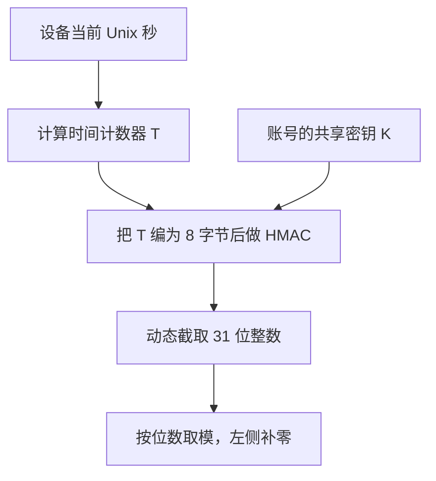

# TOTP 原理

TOTP 的全称是 Time-Based One-Time Password。网站用密码校验你知道什么，再用 TOTP 校验你是否掌握绑定时生成的密钥。验证码由设备和网站独立计算，所以生成验证码时设备可以离线。

## 开通时交换什么

网站通常为账号生成独立的随机密钥，并在绑定页将其编码为二维码。常见二维码里是 `otpauth://totp/…` 设置链接，包含 Base32 编码的密钥、账号标签，以及站点提供的位数、算法和周期。Base32 是一种把字节表示成文本的编码。网站保存原始密钥及参数，InkOTP 扫码后将它们存入本地加密库。网站通常会要求输一次验证码，确认两端配置一致。 [RFC 6238 §3–4](https://www.rfc-editor.org/rfc/rfc6238.html#section-3) · [Key URI Format](https://github.com/google/google-authenticator/wiki/Key-Uri-Format)

| 值 | 含义 |
| --- | --- |
| 共享密钥 `K` | 绑定时生成的长期随机字节。 |
| 周期 `X` | 每个时间段的秒数，通常为 30。 |
| 起点 `T0` | 时间计数的起点，常用值为 Unix 纪元 0。 |
| 算法与位数 | 常见为 HMAC-SHA-1 和 6 位。InkOTP 也支持 SHA-256、SHA-512 和 8 位，配置须与网站一致。 |

## 设备怎么出码

TOTP 复用 HOTP 的出码算法。HOTP 使用双方跟进的事件计数器，TOTP 用时间算出计数器。InkOTP 的界面生成 TOTP，HOTP 条目可以保留密钥和计数器以便迁移。 [RFC 4226 §5](https://www.rfc-editor.org/rfc/rfc4226.html#section-5) · [InkOTP 交换规格](../spec/interoperability.md)

1. 计算 `T = floor((当前 Unix 秒 - T0) / X)`，将 `T` 按 8 字节大端编码。
2. 用共享密钥对编码后的 `T` 计算 HMAC（基于哈希的消息认证码）。取 HMAC 结果最后一个字节的低 4 位作为偏移，读取偏移处的 4 字节并清除最高位，得到 31 位非负整数。
3. 对这个整数取模。6 位用 `10^6`，8 位用 `10^8`。左侧补零后显示为固定长度的字符串。 [RFC 4226 §5.3](https://www.rfc-editor.org/rfc/rfc4226.html#section-5.3) · [RFC 6238 §4.2](https://www.rfc-editor.org/rfc/rfc6238.html#section-4.2)

用 RFC 6238 附录 B 的**公开测试密钥**，取 HMAC-SHA-1、8 位、30 秒周期，可以复算下表。表里的时间是 Unix 秒，用来展示时间边界。

| Unix 秒 | 时间计数器 `T` | 验证码 |
| ---: | ---: | --- |
| 59 | 1 | `94287082` |
| 60 | 2 | `37359152` |
| 89 | 2 | `37359152` |

第一行出自 [RFC 6238 附录 B](https://www.rfc-editor.org/rfc/rfc6238.html#appendix-B)，后两行使用同一测试密钥和参数计算。仓库使用 [公共测试向量](../spec/vectors.json) 校验各端的出码结果。

## 网站怎么验码

用户把验证码填到登录页后，服务器根据账号读出绑定的密钥和参数，再用自己的时间计算预期值。常见做法是先检查当前周期，再按服务的策略检查少量相邻周期。验证码可能刚生成就跨过周期边界，因此显示 `30 秒` 的周期与用户实际剩余的输码时间是两回事。 [RFC 6238 §5.2–6](https://www.rfc-editor.org/rfc/rfc6238.html#section-5.2)

匹配后，服务端应让该验证码在有效期内只能成功一次，并限制连续失败尝试。这样做可以降低重放和猜码的风险。切换时区通常只改变屏幕上的时间显示。若设备和服务器的实际时间差过大，即使密钥和其他参数一致，两端也可能算出不同时段的验证码。 [NIST 单因素 OTP 验证要求](https://pages.nist.gov/800-63-4/sp800-63b.html#single-factor-otp-authenticators)

## 安全边界

- **绑定二维码相当于密钥。** 截图、未加密的迁移文件或 Google 迁移二维码一旦泄露，对方可以继续出码。重设网站的验证器会换掉这份密钥。
- **有效验证码可以被实时转发。** 钓鱼站可以把你刚输入的短码提交到真正的网站。TOTP 的短有效期和服务端的防重放各自降低一部分风险。 [NIST 抗钓鱼说明](https://pages.nist.gov/800-63-4/sp800-63b.html#phishing-resistance)
- **保留加密备份与网站恢复入口。** 设备遗失后，可以用自己提前导出的加密备份还原已有密钥，或通过服务提供的备用码和账号恢复流程重新绑定。 [InkOTP 备份格式与限制](../spec/interoperability.md)
